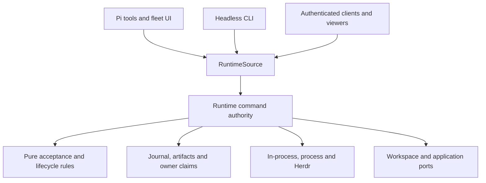

# Piñata

**Subagents for Pi, with conversations you can steer and work you can recover.**

[](https://www.npmjs.com/package/pi-pinata)
[](https://github.com/funsaized/pinata/actions/workflows/ci.yml)
[](LICENSE)

Piñata turns one [Pi](https://pi.dev) conversation into a working team. Send a scout
to trace an unfamiliar API, put builders on independent changes, and bring a
reviewer into the conversation when the diff is ready. Open any worker's transcript,
ask a follow-up, or redirect it while it works. You keep the context and decide
what to test, accept and ship.

Workers share your checkout by default, so their edits are available immediately.
For an experiment that needs its own patch, choose a Git worktree and apply the
result explicitly. The same runtime runs JSON jobs, serves authenticated terminal
clients and opens saved conversations after the host closes.

```sh
pi install npm:pi-pinata
```

[Install](#install) · [Quick start](#quick-start) · [Fleet](#fleet-and-conversations) ·
[Workflows](#workflows) · [Agents](#custom-agents) · [Configuration](#configuration) ·
[Tools](#tools) · [CLI](#cli-reference) · [API](#package-api) ·
[Implementation](#architecture-and-implementation-index) · [Development](#development)

## Why Piñata

- Delegate independent work in parallel and add workers as the task develops.
  Dependency graphs stage investigation, implementation and synthesis in one request.
- Keep a worker's conversation and workspace across follow-ups. Each assignment
  retains its own result, so later answers preserve the original evidence.
- Browse the fleet and message workers directly from Pi. Navigation and direct
  controls do not need a coordinator model turn.
- Choose shared work for immediate collaboration or worktrees for explicit patch
  selection. Dirty starting content, manual commits and partial work stay inspectable.
- Define specialists in Markdown or TypeScript. Select their models, tools, skills
  and output schemas through the same launch contract.
- Inspect failed and cancelled work, recover an original supervised attempt, and
  reconcile interrupted patch application with its journal intact.
- Use one command and event model from Pi, the headless CLI or your own host.

Piñata handles orchestration. Your coordinator owns the workflow, including testing,
review and acceptance. The shipped scout, builder and reviewer are editable
agent definitions. Compose your own roles around the work you actually do.

## Capability index

| Capability                                                | Guide and reference                                                                                                  |
| --------------------------------------------------------- | -------------------------------------------------------------------------------------------------------------------- |
| Parallel workers, staged graphs and dynamic additions     | [Workflows](#workflows)                                                                                              |
| Steering, follow-ups, continuation and cancellation       | [Control a worker](#control-a-worker)                                                                                |
| Fleet tree, transcripts, drafts, search and controls      | [Fleet and conversations](#fleet-and-conversations)                                                                  |
| Direct addressed input and explicit retry                 | [Agent mentions](#agent-mentions)                                                                                    |
| Shared files, worktrees, snapshots and dependency inputs  | [Workspaces](#workspaces)                                                                                            |
| Incremental application, rollback and writer exclusion    | [Apply isolated work](#apply-isolated-work)                                                                          |
| Markdown agents, typed reports and frozen skills          | [Custom agents](#custom-agents)                                                                                      |
| Models, reasoning, fallback candidates and tool providers | [Configuration](#configuration)                                                                                      |
| Filtered parent context and memory revision checks        | [Context and memory](#context-and-memory)                                                                            |
| Scoped child delegation and session triggers              | [Nesting](#nested-delegation), [schedules](#schedules)                                                               |
| In-process sessions, supervised processes and Herdr       | [Backends and lifetimes](#backends-and-lifetimes)                                                                    |
| Finite jobs, live control and saved-run inspection        | [Headless operation](#headless-operation)                                                                            |
| Tools, schemas, commands and exports                      | [Tools](#tools), [CLI](#cli-reference), [API](#package-api)                                                          |
| Authenticated IPC, durable events and usage               | [Events and IPC](#events-and-ipc)                                                                                    |
| Recovery and trust                                        | [Recovery](#recovery), [trust](#trust-boundaries)                                                                    |
| Source map, platforms and verification                    | [Implementation index](#architecture-and-implementation-index), [platforms](#platforms), [development](#development) |

## Install

Use Node 22.19 or later and an installed Pi host:

```sh
pi install npm:pi-pinata
```

Restart Pi to load the extension, the `subagents` skill and five prompt templates:
`/scout`, `/builder`, `/reviewer`, `/pinata-review` and `/pinata-fix`. Choose an
available provider/model in Pi. Workers use it unless a definition, configuration
or request selects another model.

For the standalone `pinata` command, install the package and Pi host peer in the
same npm prefix:

```sh
npm install --global pi-pinata @earendil-works/pi-coding-agent@1.5.0
pinata help
```

Pi's managed extension install supplies host APIs inside Pi; it does not add the
standalone CLI to your shell's `PATH`. From this checkout, use
`node bin/pinata.mjs` instead of `pinata` after `npm ci --ignore-scripts`.

Piñata targets Linux, macOS and Windows. See [platform prerequisites](#platforms)
for worker launchers and the Windows compiler requirement. Running workers uses
provider tokens. Schema discovery, input validation, ordinary tests and offline
arena controls make no model calls.

Let active work settle or cancel it before removal, then use
`pi remove npm:pi-pinata` (or the exact registered local path). For the global CLI,
use `npm uninstall --global pi-pinata`. Project files and run evidence remain
after package removal.

## Quick start

Open a project in Pi and type:

```text
@scout Map this project's entry points, data flow and tests.
```

Piñata starts the read-only scout and reports its assignment. Shift+Down opens the
fleet; Enter opens the selected conversation. Shift+Left/Right changes workers;
Shift+Up returns to the fleet and then to Pi.

After the scout finishes, send:

```text
@scout Follow the parser's error path and identify missing tests.
```

This creates another assignment in the same conversation. The first result remains
available. During active work, addressed input steers the current assignment instead.

For implementation, ask the coordinator for a concrete change:

```text
Use Piñata builders to implement the parser and command help in parallel.
Agree on the parser interface first. Inspect the diff and run the project checks.
```

The coordinator can add workers, request review, send follow-ups or finish directly.
Shared edits are already in the checkout. Completion means execution ended; the
coordinator decides whether the change is ready.

For a finite job, start with [examples/job.json](examples/job.json):

```sh
pinata run examples/job.json --workspace /path/to/project --model provider/model --json
```

Replace `provider/model` with an available model. Output names the run directory
and exact assignments. `pinata status RUN_DIRECTORY --saved --json` reads retained work.

## Fleet and conversations

The coordinator shows a compact Agents tree while work is active or queued.
Workers have activity markers, model labels and execution state; real children
branch beneath their parent. Dependencies appear as `after:` references. Failed
or interrupted work that needs attention stays visible. `/pinata` opens an idle fleet.

Fleet and conversation screens fill the terminal. Pi renders user cards, Markdown,
syntax highlighting and tool output using its theme. Completion cards show
"Subagent result" with the worker, outcome, summary and conversation command.
Backend and context metadata remain available through the details control.

| Input                                             | Action                                                      |
| ------------------------------------------------- | ----------------------------------------------------------- |
| Shift+Down                                        | Open the fleet, including from a worker conversation.       |
| Shift+Up or Escape                                | Return to the parent screen.                                |
| Up/Down, Enter in the fleet                       | Select an assignment, then open it.                         |
| Shift+Left/Right                                  | Select the previous/next worker.                            |
| Alt+Left/Right                                    | Browse earlier/later assignments for that worker.           |
| Left/Right in the fleet                           | Collapse/expand a child branch.                             |
| Mouse click/double click                          | Select/open a fleet row.                                    |
| Mouse wheel, PageUp/PageDown, Alt+PageUp/PageDown | Scroll the selected view.                                   |
| `/` in the fleet                                  | Search workers/tasks; Enter keeps the filter.               |
| `f`, `h`, `Q` in the fleet                        | Cycle all/active/failed, include history, show queued work. |
| `a` in the fleet                                  | Show actions with assignment, worker and run scopes.        |
| Tab in a conversation                             | Switch composer/transcript focus.                           |
| Ctrl+O in a conversation                          | Expand/collapse tool output.                                |
| Ctrl+T in a conversation                          | Show/hide thinking output.                                  |
| `d`, `m` with transcript focus                    | Expand details, load older pages.                           |
| Ctrl+X                                            | Stop the selected worker's pending work.                    |
| Ctrl+B                                            | Release a foreground wait.                                  |
| Ctrl+R                                            | Recover the selected original assignment.                   |
| Ctrl+L                                            | Refresh, or reconnect a disconnected attachment.            |
| Ctrl+Left/Right                                   | Cycle main, fleet and conversation screens.                 |
| `?`                                               | Show help for the current screen and focus.                 |

Conversations follow the latest saved output. Scrolling away from the bottom holds
history still; reaching the bottom resumes following. Visible live conversations
refresh once per second while following. Reading mode, hidden views and saved
sources do not poll. There is no separate follow toggle.

Short conversations sit above the composer. Message controls stay at the bottom
when output, send feedback or terminal size changes. "Message queued" means the
runtime saved your message; it does not confirm the worker has read it. Receipt
IDs remain in the expanded Subagent update card in the coordinator conversation.

Each worker keeps its own message draft, separate from the coordinator draft.
Tool and thinking toggles work from either focus and use Pi's configured shortcuts.
They leave the message draft and assignment details unchanged. Standalone viewers
use Ctrl+O and Ctrl+T; `ui.keys.expandTools` and `ui.keys.toggleThinking` override them.
A control draft clears only after durable acceptance. The composer labels whether
text will steer, follow up or continue. Question marks inside a draft remain text.
Ctrl+Left/Right, Ctrl+B and Ctrl+R retain editor behavior while composing; use Tab
for transcript controls or the commands below.

Inside a worker screen, `/worker <id> [assignment]`, `/assignment <number>`,
`/fleet` and `/main` navigate. `/steer <text>`, `/follow-up <text>` and
`/continue <text>` select the message action. `/stop`, `/stop-assignment` and
`/stop-run` have distinct scopes. Other controls are `/inspect`, `/more`, `/refresh`,
`/recover`, `/reconnect`, `/background`, `/queued`, `/scroll up|down|N`,
`/palette <name>` and `/help`. `/replace <definition> <task>` creates a worker
with the selected assignment recorded as origin.

### Agent mentions

Only leading user input is routed. A worker ID is its handle; when no worker
matches, an exact definition name starts one.

| Input                                                  | Behavior                                                                |
| ------------------------------------------------------ | ----------------------------------------------------------------------- |
| `@scout Trace the parser`                              | Start the definition, steer pending work or follow up after completion. |
| `@scout`                                               | Navigate without launching work.                                        |
| `@run-prefix:scout Inspect errors`                     | Select a visible run explicitly.                                        |
| An ambiguous handle/prefix                             | Show candidates and retain the draft.                                   |
| Embedded handles, quoted text, paths and file suffixes | Ordinary Pi input handling.                                             |

The selected run wins when it contains that worker; otherwise Piñata looks for a
unique visible match. Unknown definitions produce an error. Model output never
becomes a mention command.

Piñata records the routed envelope before dispatch. If its reply is uncertain,
use the displayed `/pinata-retry run-prefix:input-token` in the original Pi session
and run. It reuses the request, message and target. Repeated callbacks for one
input deduplicate; submitting identical text again is a new request.
See [recovery](#recovery) for session loss and retained envelopes.

### Palettes and accessibility

`/pinata-palette <name>` or `ui.palette` selects a palette. The default, `inherit`,
uses Pi's theme; the standalone viewer has its own fallback. Available names:

```text
inherit             pinata              terminal-default
catppuccin-mocha     catppuccin-latte
gruvbox-dark        gruvbox-light       tokyo-night-night
rose-pine-main      rose-pine-dawn      dracula
nord                one-dark            one-light
solarized-dark      solarized-light
```

Palette changes preserve worker state and drafts. `NO_COLOR`, `TERM=dumb` and
`terminal-default` disable palette escapes. `PINATA_ASCII=1` or `TERM=dumb` selects
ASCII glyphs. `ui.motion` accepts `full`, `reduced` or `off`; reduced/off use static
activity markers. Worker text is sanitized for terminal escapes and bidirectional controls
while preserving ordinary Unicode text.

`mode: "lean"` keeps activity compact; `observe` adds excerpts. Both retain
conversations. Context utilization comes from a timed source observation or stays
unknown. Cumulative tokens do not establish current context size. Elapsed values
labeled `observed` cover starts witnessed by that UI.

## Workflows

A worker has a frozen definition, model, tools, grants and workspace. An assignment
is one task or follow-up in its conversation, identified by `{run, worker, assignment}`.
Use references returned by receipts for results, dependencies and patches.

### Parallel work and staged graphs

Send this batch to the coordinator's `pinata_run` tool:

```json
{
  "requestId": "parser-team/start",
  "command": {
    "kind": "create",
    "workers": [
      {
        "id": "parser",
        "agent": "builder",
        "task": "Implement the agreed parser in src/parser.ts. Preserve unrelated edits."
      },
      {
        "id": "help",
        "agent": "builder",
        "task": "Update src/help.ts for the agreed parser interface."
      },
      {
        "id": "review",
        "agent": "reviewer",
        "after": ["parser", "help"],
        "task": "Review the parser and help changes. Report defects with source references."
      }
    ]
  }
}
```

Use `kind: "add"` to extend a run. Acceptance validates the whole batch atomically,
including forward references and cycles. Rejected batches reserve no worker names.
[dynamic-shared.json](examples/recipes/dynamic-shared.json) is a runnable starting point.

`after` binds a worker ID to its latest accepted assignment when the dependent is
accepted. An explicit full reference selects an earlier assignment. Later follow-ups
do not retarget edges or reopen downstream work. Dependencies become ready when
exact predecessors end with confirmed cleanup; reported blockers or failed checks
do not create an acceptance gate.

For report pipelines, declare known stages together. Workers receive previews and
`pinata_dependency` to list/read complete frozen result JSON. Use the returned
`next` as the next `offset`. List offsets count entries; result offsets count UTF-16
code units. Previews show at most eight short summaries. Pages fit within 32 KiB
and retain artifact references without reading their contents. Use `inputs` for
workspace snapshots and `context` for explicitly quoted report text.

### Control a worker

| Action       | Use                                                             |
| ------------ | --------------------------------------------------------------- |
| `steer`      | Send instructions to active or queued work.                     |
| `follow_up`  | Queue another assignment in the same conversation/workspace.    |
| `continue`   | Explicitly resume stopped/failed work with recoverable context. |
| `cancel`     | Stop an assignment, worker or run; descendants default on.      |
| `background` | Release a foreground wait while work continues.                 |
| `capacity`   | Change active assignment capacity, including descendants.       |

A follow-up queues FIFO and keeps earlier results immutable:

```json
{
  "requestId": "parser-team/error-cases",
  "command": {
    "kind": "follow_up",
    "worker": "parser",
    "messageId": "parser/error-cases",
    "text": "Add the agreed malformed-input case and report the checks you ran."
  }
}
```

Capacity defaults to unbounded. Set `execution.maxConcurrent` to a positive integer
to queue ready work; `null` removes the limit. Lowering it leaves active work running.
Aborting a wait releases the caller without cancelling workers. Cancellation retains
partial output and checks cleanup separately.

Durable acceptance, backend transport and worker consumption are separate
observations. After a lost reply, inspect the original receipt before retrying
with the same request ID and payload. Changed payloads under accepted IDs conflict.

### Build Relay

Relay parses JSONL service events, summarizes them and renders a Markdown report.
The example exercises parallel modules and dependent integration:

```text
scout -> parser -----+
      -> summarizer -+-> CLI integration -> reviewer
      -> renderer ---+
```

Create a disposable checkout; setup refuses an existing destination:

```sh
node examples/relay/setup.mjs /tmp/relay-exercise
cd /tmp/relay-exercise
```

Read `REQUIREMENTS.md` and select available models in `job.json`. The starter has
unfinished stubs, so its verifier initially fails. Run the job, then inspect it:

```sh
pinata run job.json --workspace . --watch --json
node --test
node verify.mjs
git diff
```

One scout maps interfaces, three builders implement modules, a CLI builder integrates
those exact assignments, and a reviewer reports findings. These are example choices.
The coordinator chooses checks and follow-ups. Preserve the independent expected
report and verifier while repairing implementation. Shared work needs no apply step;
Piñata does not automatically commit it.

## Workspaces

| Mode       | Behavior                                                                                    |
| ---------- | ------------------------------------------------------------------------------------------- |
| `shared`   | Work in the authorized checkout, including non-Git projects. Edits are immediately visible. |
| `worktree` | Start from a frozen Git base and apply a selected isolated snapshot explicitly.             |

Tool access and workspace mode are independent. Shared observations can include
user and other worker edits; they do not establish exclusive authorship.
Shared writers and isolated workers retain snapshots when capture succeeds.
Shared readers retain conversations and results without an automatic checkout scan.
Set `observeWorkspace: true` at creation to request that observation too.
`changes` returning `source: "unavailable"` does not mean the checkout was unchanged.
Snapshots record their observation interval and scope.

New worktrees include dirty starting content by default; `includeUncommitted: false`
selects committed content. Follow-ups keep the worktree; changing modes needs a new
worker. Manual commits, HEAD and index survive capture. Normal isolated completion
can create a private checkpoint ref without moving HEAD or the user's index.
`pinata.checkpoint: none` disables it. Failed/cancelled work stays available without
a completion checkpoint.

### Dependency inputs and setup

`inputs` composes exact immutable predecessor snapshots into an isolated destination.
Pair it with appropriate `after` ordering. Missing requested snapshots fail preparation
with retained evidence. For reports, use the dependency tool or quoted `context`.

The source checkout's `.worktreeinclude` selects ignored local regular files, such as
`.env.local` or `local/**`. Piñata freezes their identities at acceptance and copies
them during initial preparation. Changed sources, links and unsafe paths are refused
or recorded as omitted; existing destination files and follow-up edits are preserved.
Included contents are excluded from snapshots and application even if ignore rules
change. Limits are 1,000 files and 16 MiB per file. Use setup for dependencies.

Setup runs only in writable isolated work. `setup: false` disables it; a string
selects a shell command; omission can detect a root lockfile and package manager.
Shell capability is required. Detected setup without that grant is skipped with a
reason; an explicit command is rejected. `passEnv` selects safe environment names;
values are supplied at execution and are not serialized. Success is retained for
the relevant worker and input identity. Failed setup preserves partial edits; inspect
uncertain interrupted setup before deciding to run it again.

### Apply isolated work

[isolated-follow-up.json](examples/recipes/isolated-follow-up.json) starts an experiment.
Keep a live owner for continued control:

```sh
pinata serve examples/recipes/isolated-follow-up.json --workspace /path/to/project --model provider/model --json
```

In another terminal, use the printed directory and returned assignment numbers:

```sh
pinata changes RUN_DIRECTORY experiment 1 --json
pinata follow-up RUN_DIRECTORY experiment "Add the agreed boundary case" --request-id experiment/follow-up
pinata wait RUN_DIRECTORY experiment --json
pinata apply RUN_DIRECTORY experiment 2 --destination /path/to/project --request-id experiment/apply
```

Inspect the accepted `operationId` and its outcome. Later applications deliver the
delta from the last applied snapshot. Apply checks paths, objects, destination
identity and expected content. A checkout-level gate allows multiple shared writers
and excludes application while writable work is active. Unconfirmed cleanup keeps
that exclusion.

Each application journals before and after blobs and cursor meaning. `rollback` reverses
only matching destination content; later edits conflict. `reconcile` selects the
retained operation and owner epoch. Preserve journals, worktrees and artifacts until
the outcome is understood. See [recovery](#recovery).

## Custom agents

| Shipped agent | Tools                           | Purpose                                                 |
| ------------- | ------------------------------- | ------------------------------------------------------- |
| `scout`       | `read`, `grep`, `find`, `ls`    | Trace code, data flow and risks.                        |
| `builder`     | `read`, `write`, `edit`, `bash` | Implement a concrete task and report actual checks.     |
| `reviewer`    | `read`, `grep`, `find`, `ls`    | Find defects and missing evidence in a supplied change. |

Save a specialist as `.pi/pinata/agents/api-scout.md`:

```markdown
---
schemaVersion: 1
name: api-scout
handoffDescription: Map API behavior and compatibility risks.
tools: [read, grep, find, ls]
pinata:
  access: read
  color: accent.cyan
---

Trace the assigned API from callers to implementation and tests. Return source
references, compatibility concerns and unresolved questions. Do not edit files.
```

Validate with `pinata agents show api-scout --workspace . --json`, then use
`@api-scout Trace authentication errors` in Pi or `"agent": "api-scout"` in a job.

### Discovery and fields

Definitions resolve from lowest to highest precedence:

1. Packaged `agents/`.
2. `<Pi agent directory>/pinata/agents/`, normally `~/.pi/agent/pinata/agents/`.
3. Project `.pi/pinata/agents/`.

Repeatable `--definitions <directory>` replaces the list in supplied order. Invalid
selected overrides fail with path and field errors. Names match filenames and contain
a lowercase letter followed by up to 31 lowercase letters, digits or hyphens.
`agents list|show <name>|validate --json` returns source paths and digests.

| Field                            | Type/default and meaning                                                 |
| -------------------------------- | ------------------------------------------------------------------------ |
| `schemaVersion`                  | Required `1` in Markdown.                                                |
| `name`, `handoffDescription`     | Stable handle and discovery description.                                 |
| Markdown body                    | Instructions; project instructions are discovered each assignment.       |
| `model`                          | Optional exact `provider/id`.                                            |
| `modelSettings.reasoning.effort` | `off`, `minimal`, `low`, `medium`, `high`, `xhigh`, `max`.               |
| `tools`                          | Default `[]`; named tools checked against host grants/classifications.   |
| `handoffs`                       | Default `[]`; allowed child definition names.                            |
| `outputType`                     | Registered schema name, or a Zod schema in trusted TypeScript.           |
| `pinata.access`                  | `read` by default; `write` requires a grant.                             |
| `pinata.workspace`               | Default `shared`; explicit declaration overrides run workspace config.   |
| `pinata.skills`                  | Default `[]`; files/directories relative to the definition source.       |
| `pinata.fallbacks`               | Default `[]`; up to five model candidates.                               |
| `pinata.color`                   | `accent.blue/cyan/green/yellow/orange/red/pink/purple` or six-digit hex. |
| `pinata.inheritContext`          | Default `none`; `parent` requests a filtered checkpoint.                 |
| `pinata.memory`                  | Default `{ "scope": "none", "access": "read" }`.                         |
| `pinata.delegation.maxDepth`     | Default `0`; requires handoffs and a scoped host grant.                  |
| `pinata.checkpoint`              | `completion` private isolated checkpoint or `none`.                      |

Acceptance freezes the definition, model, grants, tool providers, skills and workspace
plan. A new worker adopts edited frozen resources; follow-ups preserve the accepted
worker. Project `AGENTS.md` discovery refreshes each assignment, including new or
renamed files in non-Git projects.

Only explicitly selected skills load. Piñata freezes source and resources and materializes
those bytes for execution. Skills cannot broaden tools or grants. Custom extension
providers are trusted host code; their frozen source identity is checked before load.

### Typed definitions and reports

For a typed report, export an `agents` array from an explicit bootstrap module:

```ts
import { defineAgent } from "pi-pinata";
import { z } from "zod";

export const agents = [
  defineAgent({
    name: "api-auditor",
    handoffDescription: "Map API compatibility risks.",
    instructions: "Inspect the requested API and report concrete findings.",
    tools: ["read", "grep", "find", "ls"],
    outputType: z.strictObject({
      files: z.array(z.string()),
      risks: z.array(z.string()),
    }),
  }),
];
```

```sh
pinata agents show api-auditor --bootstrap ./pinata-agents.ts --json
pinata run job.json --bootstrap ./pinata-agents.ts
```

`defineAgent` defaults `schemaVersion` to 1. Typed and Markdown definitions cannot
share a name. The optional `submit_result` worker tool accepts:

```json
{
  "summary": "Traced authentication errors.",
  "data": { "files": ["src/auth.ts"], "risks": ["Missing expiry test"] },
  "assessment": {
    "findings": ["Expiry behavior has no regression test."],
    "claimedChecks": [],
    "blockers": []
  }
}
```

`outputType` validates `data`. Zod refinements, including asynchronous refinements,
run in the original trusted validator. Discovery exposes input JSON Schema, which
cannot recreate callbacks. Transforms and non-JSON types are rejected. Failed optional
reports remain as reporting errors; ordinary final text remains valid output.

Workers freeze the selected bootstrap path, source bytes, digest and schema descriptor.
Missing or changed bootstraps fail before execution. Editing an already loaded module
requires a fresh host process and worker. Only host code or explicit `--bootstrap`
can select executable definitions.

## Configuration

Layers resolve from personal `<Pi agent directory>/pinata.json`, project
`.pi/pinata.json`, then run config. Omitted fields preserve lower layers. `models`,
`fallbacks` and `toolProviders` merge by entry; other supplied fields replace the
corresponding field. Worker overrides resolve into frozen launch data.

```json
{
  "schemaVersion": 1,
  "workspace": "shared",
  "backend": "in-process",
  "mode": "observe",
  "models": {
    "builder": { "provider": "provider", "id": "model", "thinking": "high" }
  },
  "execution": { "maxConcurrent": 4 },
  "ui": { "palette": "catppuccin-mocha", "motion": "reduced", "keys": {} }
}
```

| Field                                | Default/behavior                                                                         |
| ------------------------------------ | ---------------------------------------------------------------------------------------- |
| `schemaVersion`                      | `1`.                                                                                     |
| `workspace`                          | `shared`; optional `worktree`.                                                           |
| `backend`                            | `in-process`; optional `process`, `herdr-pi`.                                            |
| `models`                             | `{}`; per-agent model objects and optional `default`.                                    |
| `fallbacks`                          | `{}`; per-agent/default lists of up to five available-model candidates.                  |
| `execution.maxConcurrent`            | `null` (unbounded), or a positive active-assignment limit.                               |
| `mode`                               | `lean`; `observe` adds activity excerpts.                                                |
| `toolProviders`                      | `{}`; named `{extension, tools}` providers.                                              |
| `webExtension`                       | Optional provider for `web_enable`, `web_search`, `fetch_content`, `get_search_content`. |
| `passEnv`                            | `[]`; safe setup environment names, with values excluded from evidence.                  |
| `setup`                              | Omitted: detect root locked dependencies; `false`: disable; string: explicit command.    |
| `worktreeRoot`                       | Optional host worktree location.                                                         |
| `codemode`                           | `true`; Pi coding wrapper with underlying capability checks.                             |
| `includeUncommitted`                 | `true`; include dirty content in a new isolated base.                                    |
| `ui.palette`, `ui.motion`, `ui.keys` | `inherit`, `full`, `{}`.                                                                 |

Model precedence is worker request, per-agent config, definition, default config,
then parent model. Definition reasoning defaults to `off` when its model is selected.
Fallback candidates resolve before launch and retain provenance; execution failure
does not silently rerun on another model. Model objects contain `provider`, `id` and
`thinking`. Definition discovery alone does not promise model availability.

Key actions are `openFleet`, `parentScreen`, `previousScreen`, `nextScreen`,
`previousWorker`, `nextWorker`, `previousAssignment`, `nextAssignment`, `stop`,
`background`, `recover`, `refresh`, `scrollUp` and `scrollDown`. Invalid/reserved or
duplicate bindings fail explicitly; screen help reflects configured bindings.

Built-in `read`, `grep`, `find`, `ls` have read access. `write`, `edit`, `bash` and
`powershell` need write access. Custom providers default to write classification
unless host code classifies them otherwise; known web-provider tools are read-oriented.
Requests must fit the frozen tool list and grant. Loader and control environment names such
as `NODE_OPTIONS`, `LD_PRELOAD`, `DYLD_INSERT_LIBRARIES` and `PINATA_*` are refused
in `passEnv`.

### Host grants

Authority comes from the host, separately from project config and model requests. The
default host grants ordinary read/write tools and both workspace modes. Inheritance,
memory and delegation default off.

In Pi, `/pinata-grants <json>` followed by `/pinata-new` selects grants for a new run.
Personal `<Pi agent directory>/pinata/grants.json` supplies persistent grants across
workspaces; command and integration grants take precedence. Invalid personal grants fail
with their path. Accepted workers keep their grants.

Headless hosts use `--grants <file>`; integrations use `HostOptions.grants`. Inspect
`pinata.grants.v1` before editing it. The [grant recipe](examples/recipes/grants.json)
contains every required field. Project config, skills, reports and memory cannot
grant authority.

## Context and memory

`pinata.inheritContext: parent` requests a filtered parent conversation. It requires
a host grant, supporting backend and available checkpoint. Pi can supply the current
parent branch; an independent headless host without parent context reports unavailable.
Piñata retains supported messages, complete tool pairs and compaction provenance,
excluding host controls and incomplete pairs. Import does not replay tools. Use task
text or `context` for explicit quoted background.

| Memory scope    | Use                                               |
| --------------- | ------------------------------------------------- |
| `none`          | Default; no memory tools.                         |
| `worker`        | Retained notes for one worker.                    |
| `project-agent` | Notes for one agent within one canonical project. |

The host must grant the same scope and requested access. There is no cross-project
global profile. `pinata_memory_read` returns a revision; edit/clear requires that
revision. Concurrent writes conflict: read, merge and retry. Clear records an empty
revision while preserving history. Model-written notes remain subordinate to current
instructions and grants.

Pi provides direct controls without a model turn:

```text
/pinata-memory inspect scout
/pinata-memory edit scout {"expectedRevision":0,"text":"Retained notes","data":{"checked":true}}
/pinata-memory clear scout 1
```

Use the inspected revision. Inspection reports scope, value and provenance; edit replaces
the value, with optional `data`. These controls use the accepted worker's scope and
write grant, accept no path override and preserve a newer editor draft.

## Nested delegation

Enable nesting when a worker should divide a workstream and synthesize its children.
Independent tasks can remain siblings. Child ancestry comes only from the bound
`pinata_children` tool; `after`, names and origins do not establish parentage.

The [delegator definition](examples/agents/delegator.md),
[authorized job](examples/recipes/authorized-nested.json) and
[grants](examples/recipes/grants.json) form a complete opt-in example. In Pi, copy
the definition to `.pi/pinata/agents/delegator.md`, paste the grant JSON into
`/pinata-grants`, then use `/pinata-new`. For persistent personal setup, use
`<Pi agent directory>/pinata/agents/` and `pinata/grants.json`.

From this checkout:

```sh
pinata serve examples/recipes/authorized-nested.json --workspace /path/to/project --model provider/model --definitions agents --definitions examples/agents --grants examples/recipes/grants.json --json
```

The parent needs positive depth and allowed `handoffs`. The host grant must permit
depth, child definitions, tools and workspaces, and the backend must support nesting.
`pinata_agents` reports effective `delegation.enabled` and each parent's usable scope
or disabled reason. Plan from that discovery. Model config alone does not create an
agent or enable delegation.

Children use their definitions within the parent's ceiling. Read-only parents cannot
grant write access. Child tools control only descendants and never receive a root
source or IPC token. IDs share the run namespace; prefix them by workstream and
batch independent children in one add call.

Descendants share root assignment capacity. A waiting parent occupies a slot. At
capacity one, `pinata_child_wait` returns `capacity_blocked`: finish the parent with
child references, let children settle, then have the coordinator follow up with that
same parent and exact `after` references for synthesis. `dependency_blocked` also
requires ending the parent. Polling cannot free its slot. Normal parent completion
leaves accepted children running; cancellation includes descendants by default.
Completion notices do not automatically start another parent turn. The
[shipped nested instructions](skills/subagents/nested.md) contain exact patterns.

## Schedules

A live session can own a trigger that creates ordinary assignments. Creating or updating a schedule
returns a paused preview; resume explicitly after inspecting the target and next
occurrence. Every accepted occurrence can spend provider tokens.

| Trigger  | Shape                                                                           |
| -------- | ------------------------------------------------------------------------------- |
| One-shot | `{ "kind": "at", "at": "2026-12-25T09:00:00.000Z" }`                            |
| Interval | `{ "kind": "interval", "milliseconds": 300000 }`                                |
| Cron     | `{ "kind": "cron", "expression": "0 9 * * 1", "timezone": "America/New_York" }` |

Cron uses five deterministic fields and an explicit IANA timezone. Aliases and randomized
`H` fields are rejected. Missing spring-forward wall minutes are skipped; a repeated
fall-back minute runs once. Intervals use a monotonic clock.

Submit [scheduled-follow-up.json](examples/recipes/scheduled-follow-up.json) with
`pinata execute RUN_DIRECTORY <file>`, then activate it with a new envelope:

```json
{
  "requestId": "example/schedule/resume",
  "command": { "kind": "schedule", "schedule": { "action": "resume", "id": "inspect" } }
}
```

`pinata_schedule` supports create/update/list/pause/resume/delete. Targets select an
existing worker or frozen template. Overlap defaults to `skip`; `queue` is explicit.
Closing the owner stops future triggers. A crash or reload leaves schedules paused with
no catch-up. These triggers depend on a live session and do not run as OS cron jobs.

## Backends and lifetimes

| Backend      | Execution                                                                                                     |
| ------------ | ------------------------------------------------------------------------------------------------------------- |
| `in-process` | Pi sessions in the host. Default; avoids worker process startup and releases idle sessions after persistence. |
| `process`    | The same Pi adapter in a supervised Node worker with durable transport and original-attempt reattachment.     |
| `herdr-pi`   | The process protocol plus an owned Herdr monitor pane; requires an available Herdr session.                   |

Backends share the frozen contract for tools, context, skills, memory, continuation
and workspaces. Unsupported capabilities fail before launch. Missing Herdr does not
switch the request to another backend. Its monitor displays observations; steering
uses Runtime controls. Pane and terminal identity checks preserve other panes on close.

`lifetime: "attached"` stops with a lost owning host. `surviving` needs a supporting
supervised backend and preserves the original attempt after unexpected host loss.
Explicit shutdown stops both lifetimes. Waiting and lifetime are independent.
Recovery inspects the retained attempt rather than creating an empty conversation.

Payload exit does not establish descendant cleanup or complete output. The POSIX
supervisor controls its owned group through a live nonce-bound authenticated channel.
Windows uses a creation-time Job Object. Stopped receipts require matching ownership
and termination evidence. Missing, escaped or ambiguous activity stays unconfirmed and
retains writer exclusion. Process output drains and synchronizes separately from payload
exit. Each tiny streaming chunk incurs durable transport work, which can affect
completion latency.

## Headless operation

A schema-1 job has `workers` and optional layered `config`:

```json
{
  "schemaVersion": 1,
  "workers": [{ "id": "map", "agent": "scout", "task": "Map project entry points and tests." }]
}
```

`run` waits for finite accepted work, reports results and closes its host. `serve`
keeps a foreground owner available for new workers, follow-ups and schedules,
without starting a coordinator model:

```sh
pinata serve examples/job.json --workspace /path/to/project --model provider/model --json
```

Use its printed directory from another terminal:

```sh
pinata attach RUN_DIRECTORY
pinata status RUN_DIRECTORY --json
pinata follow-up RUN_DIRECTORY map "Inspect error handling" --request-id map/errors
```

Git projects use a store under the common Git directory; non-Git projects use
`.pinata/runs`. `--directory` selects an explicit run store. Canonical workspace
identity handles aliases consistently.

After the owner closes, use `--saved` for status, results, conversations and changes.
For live control, explicitly `pinata serve --directory RUN_DIRECTORY` and inspect
`recover`. `view --control` requests a control attachment; saved sources cannot
mutate. Isolated results still need explicit application.

## Tools

Pi supplies tool schemas automatically. Start with `pinata_agents` for definitions
and effective capabilities. Inspect installed contracts with `pinata tools --json`,
`pinata schema <name> --json` or the [generated JSON catalog](docs/reference/catalog.json).

| Coordinator tool   | Input/purpose                                                                        |
| ------------------ | ------------------------------------------------------------------------------------ |
| `pinata_run`       | `command`, optional `requestId`; create/add/follow-up/continue/capacity/background.  |
| `pinata_steer`     | `worker`, `messageId`, `text`, optional `requestId`.                                 |
| `pinata_cancel`    | `scope`, applicable `worker`/`assignment`, optional `descendants`, `requestId`.      |
| `pinata_wait`      | Optional `workers` or exact `targets`, and `next`.                                   |
| `pinata_status`    | Canonical `query`, default status.                                                   |
| `pinata_agents`    | Discover definitions, model defaults and effective grants.                           |
| `pinata_changes`   | Exact `ref`; inspect retained workspace changes.                                     |
| `pinata_integrate` | Exact `ref`, `destination`, optional `requestId`; observe its application operation. |
| `pinata_rollback`  | `operation`, `destination`, optional `requestId`.                                    |
| `pinata_schedule`  | `schedule` action, optional `requestId`.                                             |
| `pinata_recover`   | Optional exact `targets`; inspect/reattach original attempts.                        |
| `pinata_page`      | `cursor` returned from a paged tool reply.                                           |

| Worker tool                                 | Availability                                                 |
| ------------------------------------------- | ------------------------------------------------------------ |
| `submit_result`                             | Optional report; `outputType` can refine `data`.             |
| `pinata_dependency`                         | Exact frozen dependency results only.                        |
| `pinata_children`                           | Explicit scoped delegation grant.                            |
| `pinata_child_status`, `pinata_child_wait`  | Same grant; descendants only.                                |
| `pinata_page`                               | Previously exposed child-tool output in this worker session. |
| `pinata_memory_read`                        | Granted worker/project-agent memory.                         |
| `pinata_memory_edit`, `pinata_memory_clear` | Scoped memory write grant and expected revision.             |

Coordinator `details` retain `pinata.surface-reply.v1`; `pinata_page` returns
`pinata.tool-page-reply.v1`. Model content fits within 32 KiB. Larger replies return
immutable UTF-8 JSON fragments with offsets, digest and `nextCursor`. Pass it as
`cursor` to `pinata_page` and concatenate `text` in offset order. Details, CLI JSON
and immutable evidence retain the full value. Cursors expire with the host and
cannot address arbitrary files or artifacts. After reconnect, re-query the read or
original receipt for fresh pages.

### Commands and queries

Envelopes contain `requestId`, optional `expectedRevision` and `command`. Accepted
receipts name the revision, exact assignments, messages and any application operation.
Stale expected revisions reject. Stable IDs make acceptance retries idempotent;
they do not promise exactly-once arbitrary external tool effects.

| Command                  | Behavior                                                             |
| ------------------------ | -------------------------------------------------------------------- |
| `create`, `add`          | Atomically accept worker batches; `create` can include config.       |
| `follow_up`              | Queue with `worker`, `messageId`, `text`, optional `after`/`inputs`. |
| `steer`, `continue`      | Address a worker with message ID/text.                               |
| `cancel`                 | Assignment/worker/run scope; descendants default on.                 |
| `background`, `capacity` | Release a wait or select positive/null `maxConcurrent`.              |
| `schedule`               | Manage session triggers.                                             |
| `apply`                  | Apply an exact snapshot to the frozen destination with exclusion.    |
| `rollback`, `reconcile`  | Recover a selected journaled application.                            |

Worker requests require `id`, `agent`, `task`. Optional fields: `origin`, `messageId`,
`after`, `inputs`, `workspace`, `observeWorkspace`, `model`, `backend`, `lifetime`,
`context`, `inheritContext`, `memory`, `delegation`. `origin` identifies an earlier
assignment in the same run. It copies no context or files and adds no dependency;
supply these explicitly when replacing work.

Queries: `status`, `config`, `receipt`, `result`, `events`, `schemas`, `definitions`,
`conversation`, `changes`, `application`, `wait`. Result/conversation/changes select
`ref`; receipt selects `requestId`; application selects `operationId`. Conversation
paging uses returned `cursor`; events use `since`. Unnamed model-facing schema
discovery returns an index. Request a named schema or tool for its fields.

### Errors and versions

| Domain error          | Meaning                                                     |
| --------------------- | ----------------------------------------------------------- |
| `invalid_input`       | Malformed/rejected fields.                                  |
| `dependency_missing`  | Unavailable assignment reference.                           |
| `capability_denied`   | Request exceeds authority.                                  |
| `unsupported`         | Selected host/backend/resource lacks capability.            |
| `conflict`            | Stale revision, changed accepted payload, state or content. |
| `owner_unconfirmed`   | Ownership/cleanup cannot be established.                    |
| `context_unavailable` | Retained conversation/resource cannot be restored.          |
| `commit_unknown`      | Durable write outcome is uncertain; inspect the receipt.    |

Surface errors also include `internal_error`, `protocol_version`, `unauthenticated`,
`transport_closed`, `transport_limit`, with an optional field where useful.

| Contract                          | Version/schema                                                      |
| --------------------------------- | ------------------------------------------------------------------- |
| Job/config                        | `1`: `pinata.job.v1`, `pinata.config.v1`, `pinata.config-layer.v1`. |
| Definition                        | `1`: `pinata.definition.v1`.                                        |
| Manifest                          | `1`: `pinata.manifest.v1`.                                          |
| Journal                           | `1`: `pinata.journal.v1`.                                           |
| Event                             | `1`: `pinata.event.v1`.                                             |
| IPC                               | `1`: `pinata.ipc-*.v1`.                                             |
| Application journal               | `1`: `pinata.application-journal.v1`.                               |
| Commands/workers/results/surfaces | Named version-1 schemas in the catalog.                             |

Package and data versions are independent; unknown versions fail explicitly.
JSON Schema describes shape. Canonical validation also checks grants, graph
references, resource identity and journal consistency. Pi may coerce scalar tool
input before validation; CLI and IPC do not.

## CLI reference

`pinata help` prints installed grammar; `--json` emits one JSON value per line.
Use `-` for stdin where a file argument is accepted.

| Command                                                | Purpose                                                                                  |
| ------------------------------------------------------ | ---------------------------------------------------------------------------------------- |
| `run <job.json>`                                       | Finite job, optional `--watch`, then close owner.                                        |
| `serve [job.json]`                                     | Live owner; `--directory` reopens a retained run.                                        |
| `attach <directory>`                                   | Terminal viewer or noninteractive/JSON status.                                           |
| `view <directory>`                                     | Live/saved viewer; optional `--control`, `--palette`.                                    |
| `request <directory> <file>`                           | Surface call; mutations require `--control`.                                             |
| `execute <directory> <file>`                           | Canonical envelope.                                                                      |
| `query <directory> <file>`                             | Canonical query.                                                                         |
| `status`, `logs`                                       | Observe directory; optional `--watch`, logs `--since <revision>`.                        |
| `result`, `conversation`, `changes`                    | `<directory> <worker> [assignment]`; omitted assignment resolves latest at request time. |
| `wait <directory> [worker ...]`                        | Freeze exact current assignments; optional `--next`.                                     |
| `steer`, `follow-up`, `continue`                       | `<directory> <worker> <message>`; preserve `--request-id` after uncertainty.             |
| `cancel <directory>`                                   | `--scope assignment`, `worker` or `run`, with applicable `--worker`/`--assignment`.      |
| `background`, `recover`                                | `<directory>`; release wait or inspect original attempts.                                |
| `apply`                                                | `<directory> <worker> <assignment> --destination <checkout>`.                            |
| `rollback`                                             | `<directory> <operation> --destination <checkout>`.                                      |
| `reconcile`                                            | `<directory> <operation> --owner <epoch>`.                                               |
| `schema [name]`, `tools`                               | Discover canonical schemas and tool contracts.                                           |
| `agents list`, `agents show <name>`, `agents validate` | Discover/validate definitions.                                                           |

Host options: `--workspace`, `--directory`, `--run`, `--agent-dir`, repeatable
`--definitions`, `--config <json-file>`, `--grants <json-file>`, `--model provider/id`,
`--thinking <level>`, trusted `--bootstrap <module>`. `--factory <module>` selects a
trusted test/integration module exporting `openHost`. Read-only commands use `--saved`.

Exit codes: `0` successful execution/observation, `1` failed/uncertain execution or
application, `2` invalid/rejected input, `3` cancellation. These describe execution,
separately from code quality. Aborting attached waits leaves workers running;
closing the owner performs shutdown and cleanup.

Pi commands: `/pinata`, `/pinata-main`, `/pinata-fleet`,
`/pinata-conversation <worker> [assignment]`, `/pinata-palette <name>`,
`/pinata-schema <name>`, `/pinata-grants <json>`, `/pinata-new`,
`/pinata-retry <run>:<input-token>`, `/pinata-memory inspect|edit|clear ...`.

## Package API

Root `pi-pinata` exports `defineAgent`, `openHost`, `Runtime`, `bindRuntime`,
`AttachedSource`, `openSavedSource`, `startIpcServer`, `ToolPages`, `toolContentBytes`,
`exportSchemas`, `parseSchema`, `schemaRegistry`.

Public types: `AgentDefinitionInput`, `DefinedAgent`, `Host`, `HostOptions`,
`RuntimeOptions`, `RuntimeSource`, `AssignmentRef`, `CallerAuthority`,
`CommandEnvelope`, `CommandReceipt`, `RuntimeEvent`, `SurfaceCall`, `SurfaceReply`.

| Entry                 | Boundary/exports                                                                                                                             |
| --------------------- | -------------------------------------------------------------------------------------------------------------------------------------------- |
| `pi-pinata`           | Full root host API; loads Pi SDK.                                                                                                            |
| `pi-pinata/host`      | `openHost`, `defineAgent`, `builtinTools` and host types.                                                                                    |
| `pi-pinata/runtime`   | Pi-independent `Runtime` and port/options types.                                                                                             |
| `pi-pinata/contracts` | Schemas/types, `versions`, `assignmentKey`, `canonicalJson`, `digestValue`, `DomainError`, `exportSchemas`, `parseSchema`, `schemaRegistry`. |
| `pi-pinata/sources`   | `RuntimeSource`, `bindRuntime`, `callRuntime`, `surfaceError`, `SurfaceFailure`, `ToolPages`, `toolContentBytes`.                            |

The `.mjs` bridges install a package-scoped TypeScript loader for `node_modules`
on supported Node versions; native Pi/Bun uses its own support. Internal paths
are outside the public compatibility API.

### Open a host

```ts
import { openHost } from "pi-pinata";

const host = await openHost({
  workspace: "/path/to/project",
  parentModel: { provider: "provider", id: "model", thinking: "off" },
});

try {
  const receipt = await host.runtime.execute(
    {
      requestId: "api/map",
      command: {
        kind: "create",
        workers: [{ id: "map", agent: "scout", task: "Trace public entry points." }],
      },
    },
    host.caller,
  );
  if (receipt.status === "rejected") throw new Error(receipt.error.message);
  console.log(await host.runtime.wait({ targets: receipt.assignments }, host.caller));
} finally {
  await host.close("Integration finished");
}
```

`openHost` binds workspace identity, definitions, models, adapters and grants. It
returns `runtime`, `caller`, `source`, `workspace`, `directory`, resolved `config`
and asynchronous `close(reason)`. Retained manifests must match the workspace/run.
Close records cleanup, including unconfirmed ownership.

`HostOptions` accepts `workspace`, `directory`, `run`, `sessionId`,
`agentDir`, ordered `definitionDirectories`, layered `config`, `parentModel`,
`parentContext`, `grants`, `modelRuntime`, `bootstrapModule`, `nodeCommand`, `backends`,
`tools`, `notifications`, `onDiagnostic`. These are trusted integration inputs.
The bootstrap can export `agents` and/or `configureModelRuntime(runtime, manifest?)`.
Injected model runtimes skip the hook in the owner; process workers invoke it for
their runtime.

### Runtime and sources

`Runtime.open(options)` is the command authority. `RuntimeOptions` supplies a durable
directory and optional manifest, worker and config resolvers, definition discovery, execution
backends and workspace, application port, scheduling owner, notifications and diagnostics.
`fault` and `effectPort` are deterministic test seams.

| Method                                                | Contract                                                                       |
| ----------------------------------------------------- | ------------------------------------------------------------------------------ |
| `execute(envelope, caller)`                           | Durably accept/reject; accepted retries return the original receipt.           |
| `query(query, caller)`                                | Typed state, results, receipts, events, definitions, schemas and observations. |
| `wait(request, caller, signal?)`                      | Freeze targets; abort leaves work running.                                     |
| `subscribe(request, caller, consume)`                 | History/snapshot then live events; returns unsubscribe.                        |
| `recover(request, caller)`                            | Inspect/reattach original attempts.                                            |
| `close({reason})`                                     | Close schedules, stop owned work, report cleanup.                              |
| `bindChild(parentRef)`                                | Authority-bound child port.                                                    |
| `parentCheckpoint(ref, caller)`                       | Supported parent conversation checkpoint.                                      |
| `scheduleTick()`                                      | Evaluate injected scheduling clock.                                            |
| `deliverNotifications(caller)`                        | Deliver durable notices through host port.                                     |
| `recordNotificationConsumption(id, artifact, caller)` | Record exact notice consumption with retained checkpoint.                      |
| `diagnostics()`                                       | Observer/execution diagnostics.                                                |
| `dispatch(ref, caller)`                               | Injected inert test effect port.                                               |

`bindRuntime(runtime, caller)` binds `request`, `snapshot`, `subscribe` to fixed
authority. `RuntimeSource` also reports run/capabilities. `AttachedSource.connect`
uses authenticated IPC with explicit `reconnect`, connection listeners and `close`.
Reconnect resynchronizes observations without replaying mutations.
`openSavedSource(directory)` is read-only. `startIpcServer` accepts separate
control and viewer sources and returns a link and asynchronous close.

`new ToolPages({artifacts, scope})` binds a trusted `ArtifactPort` and run/worker
scope. `format(value)` preserves small JSON and stores larger immutable replies;
`read(cursor)` returns exact UTF-8 fragments. Cursors authorize only already-exposed
output. Paging failures retain original details and recovery guidance without changing
command receipts.

### Extension ports

`WorkerResolver` freezes definitions, grants, loadouts and workspace plans before
acceptance. `BackendPort` advertises restoration, steering, context, skill, memory,
delegation, fallback, lifetime and cleanup capabilities. Start and reattach handles own
input receipts, observations, completion, checkpoints and stop receipts.

`WorkspacePort` owns prepare/recover/capture/release, retaining writer registration
until confirmed cleanup. `RuntimeApplicationPort` performs journaled application
outside command serialization. `NotificationPort` distinguishes stable notice
transport from model consumption; Pi needs the complete notice in the outgoing
provider payload and a retained parent branch to record consumption. `onDiagnostic`
observes adapter/subscriber failures. New surfaces should use `RuntimeSource`
and preserve cancellation, context and recovery through these ports.

## Events and IPC

`pinata.event.v1` distinguishes durable `committed` transitions, replay `snapshot`
projections and transient `activity`. Revisions order history; `ownerEpoch` identifies
ownership generations. Activity source and ordinal support deduplication. Subscribers
can coalesce activity or reset to snapshots; activity gaps do not imply missing commits.

History records assignments, effect intent and observation, backend enrollment, input
transport and consumption, conversations, usage, output, cleanup, snapshots, settlement,
schedules and application. Results and notices use exact assignments, keeping earlier
and later results distinct.

Usage reconciles per assignment and attempt with uncached input, output, cache reads and writes
and optional cost. Missing or conflicting coverage keeps totals unknown while retaining
partial observations. Price estimates, invoices and context utilization are separate.

IPC protocol 2 binds loopback and records run, server and owner identities with separate
viewer and control credentials. A versioned hello supplies role and token. Root control
credentials must stay outside worker transports and model prompts. Exact handshakes,
frames and limits are in `pinata.ipc-*.v1`.

Transport IDs and durable mutation IDs serve different purposes. After disconnect,
query the mutation receipt. Chunking preserves full replies; bounded queues and
acknowledgments let slow subscribers reset to authoritative snapshots. `abort_wait`
stops only that wait. Viewers cannot mutate, recover or claim ownership. Invalid frames,
chunks, credentials and versions are refused before dispatch. Notice delivery
receipts deduplicate by stable ID, separately from consumption.

## Recovery

Start with status, results, conversations and changes for the exact assignment; use
`--saved` without an owner. Shared files, isolated snapshots and worktrees remain
inspectable after failure or cancellation.

| Situation                 | Action                                                                     |
| ------------------------- | -------------------------------------------------------------------------- |
| Lost live connection      | Reconnect to the existing owner.                                           |
| Uncertain mutation reply  | Query original `requestId`, then retry the same payload/ID if appropriate. |
| Uncertain mentioned input | Use displayed `/pinata-retry` in original session/run.                     |
| Host died                 | Explicitly `serve --directory RUN_DIRECTORY`, then inspect `recover`.      |
| Stopped work has context  | `continue`; otherwise create a replacement with origin/context.            |
| Interrupted application   | Query the operation and reconcile journal/owner first.                     |
| Rollback conflicts        | Preserve later edits and resolve explicitly.                               |

`recover` returns `reattached`, `finalizing`, `active`, `unavailable` or `uncertain`.
It never automatically launches a replacement. Missing sessions remain explicit errors.

Checksum-verified mention envelopes sync to `RUN_DIRECTORY/mention-inputs/` before
dispatch, even if Pi never saved its first custom-only session. Direct Pi retry
still requires the original session binding. If lost, inspect the retained envelope
and use explicit canonical request recovery; do not infer a new action from text.

Owner claims have exact identities and epochs and never expire by age. Reconciliation
needs current proof the selected owner is inactive. Live, remote or uncertain owners
stay blocked for their matching host. Preserve before and after blobs, journals, worktrees
and cleanup receipts. Deleting ownership files or resetting the checkout discards
recovery evidence.

## Trust boundaries

The host binds caller identity, workspace roots, tools and grants. Model requests,
definitions, skills, memory and output are data validated within those bindings.
They cannot replace their caller, select a root token or broaden authority.

Worktrees isolate patches. Shell tools and custom extensions execute with the host account's
operating-system permissions. Use an external sandbox for untrusted code. Checkout
gates and claims coordinate cooperating processes, without containing hostile same-user
mutation.

Durable recording, transport delivery, consumption, execution, worker assessments,
reported checks, coordinator acceptance, application and oracle correctness remain
distinct. Piñata imposes no automatic reviewer, mandatory ownership allocation,
production token or time budget, or verification-dependent access to completed work.

Durability assumes local atomic create and link operations and file fsync. POSIX
directory fsync is exercised; equivalent Windows directory durability, machine
power loss and network filesystems are outside demonstrated coverage. Torn or corrupt
records and ambiguous effects require explicit inspection and reconciliation.

## Platforms

| Platform          | Prerequisites/validation                                                                                                                                                            |
| ----------------- | ----------------------------------------------------------------------------------------------------------------------------------------------------------------------------------- |
| Linux/macOS       | Node 22.19+. CI runs full offline tests, Pi/package smokes and advisory measurements on Node 22.19/24.                                                                              |
| Windows x64/ARM64 | Node 22.19+ and .NET Framework 4 C# compiler. Targeted CI covers portable contracts/storage, supervision, Pi process workers, package installation and native-host default workers. |
| Herdr             | Available local session; unavailable conditional cases are skips.                                                                                                                   |

Development pins Pi SDK 1.5.0. CI exercises native Pi 1.1.0 compatibility and selects
native Pi 1.5.0 for benchmarks. Native hosts and Node workers are separate environments.
Native Pi launches workers through `node` on `PATH`; trusted hosts can select
`HostOptions.nodeCommand`. A Node Pi host uses its current Node executable.

Windows builds packaged `PinataJobLauncher.cs` on first use, caching under
`%LOCALAPPDATA%\\Pinata\\job-launcher` by source/compiler/architecture. A receipt
verifies the executable; no runtime or helper is downloaded. A missing compiler or changed
cache fails launch. Job membership is established during `CreateProcessW` with
`PROC_THREAD_ATTRIBUTE_JOB_LIST` and restricted inherited handles. The job handle
is not inherited; kill-on-close owns descendant lifetime.

Executable arguments and Unicode environments are preserved. `.cmd`/`.bat` disables
delayed expansion and rejects special shell characters; use an executable for arbitrary
ordinary argument data. Cleanup requires matching empty-and-closed job evidence
and guardian termination. Lost acknowledgments stay unconfirmed. Saved PIDs, job
names and `taskkill` are not cleanup authority. Job inheritance is not a permission
sandbox.

Windows tests cover creation crashes, nested jobs, descendant-held pipes, arguments,
cancellation, reconnect and host loss. Full workspace and application fault matrices
and terminal navigation run on Linux/macOS. Test reports identify the actual host
and worker runtimes; an executable label alone does not establish runtime coverage.

## Architecture and implementation index

Every surface uses one Runtime, scheduler, command authority and event model.
Pure contracts and core rules stay independent of Pi and filesystem effects.



The journal records acceptance and effect intent before dispatch. Immutable artifacts
sync before committed references. Checkpoints and projections speed reads while committed
history stays authoritative. Long workspace and application operations stay outside
command serialization. Recovery uses saved launch, session and cleanup evidence to
reattach the original attempt or report uncertainty.

The source tree groups implementation by responsibility. Regression suites live in
`test/engine/` alongside scripted fixtures.

```text
pinata/
|-- engine/
|   |-- contracts/       # Schemas, versions, events and public boundaries
|   |   `-- schemas.ts   # Named schema registry
|   |-- core/            # Pure acceptance, graph, readiness and lifecycle rules
|   |-- runtime/         # Command authority, execution and controls
|   |-- storage/         # Journal, replay, artifacts and owner claims
|   |-- definitions/     # Markdown and typed agent definitions, frozen loadouts
|   |-- host/            # Workspace, models, adapters and grants
|   |-- agent/           # Pi sessions, tools, reporting and guards
|   |-- backends/        # In-process, process and Herdr execution
|   |   `-- supervision/ # Process ownership, output and Windows Job Objects
|   |-- workspace/       # Worktrees, snapshots, setup and writer exclusion
|   |-- application/     # Journaled apply, rollback and reconciliation
|   |-- context/         # Instructions, filtering and restoration
|   |-- memory/          # Scoped memory and revision history
|   |-- schedules/       # Session schedules, DST and overlap handling
|   |-- pi/              # Extension tools, mentions, grants and notices
|   |-- ipc/             # Authenticated transport and protocol negotiation
|   |-- sources/         # Live and saved runtime access, paging
|   |-- headless/        # CLI arguments, commands and output
|   |-- viewer/          # Standalone terminal viewer
|   `-- ui/              # Fleet, transcripts, palettes and drafts
|-- bin/pinata.mjs       # CLI launcher
|-- agents/              # Shipped agent definitions
|-- prompts/             # Coordinator and workflow prompts
|-- skills/              # Pi subagent skill
|-- examples/            # Jobs, recipes and Relay integration
|-- docs/reference/      # Generated schema and tool catalog
|-- test/engine/         # Contract, runtime and integration regressions
|-- bench/               # Scripted and loopback overhead measurements
|-- arena/               # Repeatable coding trials and retained evidence
|-- scripts/             # Catalog generation, checks and package releases
`-- .github/workflows/   # CI, npm publishing and package mirror
```

## Development

Use Node 22.19+ and retain the lockfile. Pin direct development dependencies;
Pi stays an optional host peer. Read [STYLE.md](STYLE.md) and [AGENTS.md](AGENTS.md)
before editing source.

```sh
npm ci --ignore-scripts
npm run check
npm test
```

`check` runs Oxfmt, Oxlint and TypeScript. Format changed files with
`npm exec -- oxfmt --write <paths>`. The scripted test suite makes no paid model calls.
It runs ordinary files with at most two concurrent files, then exhaustive apply and
rollback fault matrices separately. Test timeouts supervise fixtures, rather than
imposing production worker deadlines.

Focused and integration checks:

```sh
node --test test/engine/rewrite-contracts.test.ts
node --test test/engine/rewrite-child-backends.test.ts
node test/engine/pi-smoke.ts
node test/engine/package-smoke.ts
npm run arena -- --offline
node scripts/reference.ts --check
node scripts/public-api.ts --check
```

Pi smoke uses the public RPC host with a scripted provider. Package smoke packs the
manifest, installs runtime dependencies in a scratch prefix, imports public APIs and
loads the extension, skill and prompts through Pi. `PINATA_PI` selects an absolute
executable. Test native Pi's default worker launcher with
`PINATA_PI=/path/to/native/pi node test/engine/native-backend-smoke.ts`.
`PINATA_NATIVE_BACKEND_ALLOW_NODE=1` explicitly permits and labels a Node host instead.

<details>
<summary>Terminal captures and live integration</summary>

The offline terminal driver uses an isolated agent directory, rejects provider
requests and retains PTY bytes, events and colored frame HTML:

```sh
python3 test/readiness/rewrite-ui-pty.py --root "$PWD" \
  --out bench/results/rewrite-ui-unique \
  --pi node "$PWD/node_modules/@earendil-works/pi-coding-agent/dist/cli.js"
```

It checks widths, palettes, streaming, navigation, drafts and disposal. F12 is test
instrumentation. Render requests and actual terminal paint are separate measurements.

The `Live Pinata/Pi contract` workflow uses `OPENAI_API_KEY` on trusted PRs,
`master` pushes and manual runs. Fork/Dependabot PRs skip it. It uses
`gpt-5.4-mini-2026-03-17`, thinking off, at most 256 output tokens and 64 KiB of input
per request. Two assignments permit at most 24 HTTP attempts total, with HTTP retries
disabled. It checks read-only grants, typed reporting, continuation, usage, cleanup
and saved replay. Failed attempts retain request and usage evidence too; credential
directories stay outside uploads.

With token-spend authorization and the key already set, run
`node test/engine/live-openai-smoke.ts`. Ordinary tests use a fake transport.

</details>

### Writing and Vale

This README is the maintained guide and reference. Tools consume the separate JSON
catalog. Agent definitions, prompts, skills, repository instructions and executable
example fixtures remain separate functional inputs. The checked-in code, contracts,
tests and evaluation harness define the release behavior.

```sh
npm run docs:setup
npm run docs:lint:changed
npm run docs:lint:agents -- --changed
```

Setup installs checksum-verified Vale 3.26.0, Google 0.7.1 and ai-tells 1.37.0 in
ignored `.vale/` directories. It supports x64/ARM64 on Linux/macOS/Windows and uses
system `tar`. Ordinary scans need no network/model calls.

`docs:lint` checks reader prose; the agents profile checks spelling, repetition and
terminology in operational inputs. `--changed` covers staged/unstaged/untracked
prose against HEAD. Include branch commits with
`npm run docs:lint:changed -- --base origin/master`.
`node scripts/vale.mjs --json` emits JSON; CI retains both profile reports.

All v1 findings are advisory; missing tools, invalid configuration and execution
errors fail. Inspect output and fix useful findings. Preserve technical qualifications
when a suggestion changes meaning. Review claims against code and use a humanizer
pass to remove filler, inflated claims and repetitive phrasing while preserving
commands, grants, recovery steps and evidence limits. `.vale.ini` selects rules;
local terminology/vocabulary live under `.vale/styles/`. Use inline code for identifiers.

### Performance

Scripted and HTTP loopback benchmarks measure coordination, storage, sessions and cleanup.
Coding quality is evaluated separately.

```sh
npm run bench
npm run bench:loopback
npm run bench:process -- --repeat 5 --scenario fanout-1 --scenario fanout-8
PINATA_PI=/path/to/pi npm run bench -- --host tui --scenario ux-8
node --expose-gc bench/viewer.ts --repeat 3
```

Workloads cover fan-out at 1/8/32/64 workers, dependencies, mixed work and streaming.
Scale probes are `scale-queue-1000`, `scale-fanin-256`, `scale-batches-8`; select with
`--scenario`. `--sweep --workers 1,8 --histories 1,128` controls retained history.
Independent axes: `--mode lean|observe`, `--viewer attached|detached`,
`--workspace shared|worktree`, `--backend in-process|process|herdr-pi`,
`--lifetime attached|surviving`.

<details>
<summary>Measurement gates and interpretation</summary>

`bench/budgets.json` retains accepted named profiles and the 2× CI tolerance.
On controlled hardware, enforce them with:

```sh
PINATA_PI=/path/to/pi node scripts/bench-ci.mjs engine --expose-gc bench/run.ts --ci --host pi
```

Shared-runner CI gates execution, accounting and cleanup and reports timing as advisory.
The wrapper uses `os.tmpdir()` unless `PINATA_BENCH_ROOT` selects a root. CI uses
`/dev/shm` on Linux and runner temporary storage on macOS. It retains complete
successes/failures under `bench/results/` with original-path mapping and filesystem
identity. Direct `bench/run.ts` measures beside `--out`; `--ci` does not select a
medium. Comparisons require matching storage provenance and named profiles.

A complete in-process over-budget attempt may retry twice; all attempts remain.
Missing measurements, incomplete usage, failed execution or unconfirmed cleanup
fail immediately. Process and Herdr timing is advisory without matching baselines.
Unavailable backends stay unavailable. Mac/APFS profile selection needs observed
filesystem and device proof; Linux limits remain unchanged.

Startup covers committed preparation through the first ordinary workload provider
request. Setup, acceptance, command-to-request and dependency dispatch use different
boundaries. Compaction requests retain separate identities; full elapsed time, CPU and usage
includes compaction. RSS samples are lower bounds with host and child coverage labeled.
Collected heap can grow with history; descriptor counts do not establish timer coverage.

The UI target is p95 event/key-to-render-request at most 100 ms with eight scripted
workers. Terminal paint is measured separately. Resource probes require stable owned
counts and confirmed runtime and supervisor cleanup. The HTTP fixture observes closure
of its own idle connections before sampling.

Retain raw cells and incomplete and failed attempts at unique paths. The wrapper forwards
interrupts and waits to retain files; SIGKILL cannot run the final copy, so synced
command status identifies the original directory. Match source, lockfile, scripts,
tools, runtime, hardware, storage and launcher. Compare measurements only when their
boundaries and coverage match. No Windows latency baseline is accepted.

Before attributing an arena improvement to runtime optimization, matched profiles
must show overhead accounts for at least 10% of the affected path. Smaller changes
remain local improvements. Retain source closures, raw attempts and the exact
measurement profile with each result.

</details>

### Coding arena

The arena runs repeatable assignments with independent oracles and complete
trial evidence. Offline controls copy or mutate known solutions to test the harness:

```sh
npm run arena -- --offline
npm run arena -- --offline --task team-board@1 --workflow parallel-review
node arena/report.ts COMPLETE_BATCH_OR_MATRIX_DIRECTORY
npm run arena:bootstrap
npm run arena:doctor
npm run arena:local -- --agent pinata --preview
```

The corpus includes Checkout, Reservations, Incidents and Team Board. Task definitions
freeze prompts, starters, solutions and oracle cases. Changes require a new task version. Bootstrap
overwrites generated `arena/local/{codex,pi,pinata}.json`. Doctor checks executable
startup and configuration; preview prints commands and prompts. Neither establishes model
authentication or availability or spends tokens.

Native and external trials require separate token-spend authorization and
`--allow-external`, for example `npm run arena:local -- --agent pinata --task
checkout --allow-external`. Requested `--concurrency N` is an experimental condition
whose meaning can differ across frameworks.

<details>
<summary>Evidence, adapters and comparisons</summary>

Batches durably record cell IDs, ordering, conditions, limits and source and task digests
before launch. Started cells without published results read `interrupted_unknown`.
Pending, failed, timed-out and interrupted cells stay in the denominator. An uncertain
active cell needs explicit reconciliation before retry. Reports preserve all attempts
at new paths.

Results separate execution, oracle correctness, capabilities, usage and workflow
attestation. Missing, corrupt or conflicting observations keep totals unknown, including
missing child records. Outer process supervision does not attest inner planning,
delegation or review. Native and external workflow comparison eligibility stays false
until independently attested. A passed oracle establishes only tested candidate
contracts; it does not establish framework superiority.

Oracles use a separate Node process with filesystem permission flags, fresh IPC,
no credentials and a trusted score channel. Candidate stdout cannot supply a score.
These are process guardrails. Use independent isolation for untrusted code;
network confinement and hostile native-code containment are outside demonstrated coverage.

External configs contain `schemaVersion`, `adapter`, `condition`, optional `limits`,
validated by [adapter schemas](arena/adapters.ts). Commands run in the candidate
checkout with an absolute request-file argument. Return one JSON response on stdout;
Stderr and raw streams remain. Requests disclose no private oracle or reference solution
paths. The native Piñata adapter loads the extension with ordinary coding tools
and the shared command API.

Source evidence includes declared harness, runtime and corpus roots, untracked source and
package and lockfile configuration, excluding credentials and results. External dependency
coverage stays partial. Candidate snapshots are immutable and timed, with capture cost
separate. Match task version, starting files, model and settings, prompts, tools, limits,
host and workflow; record unmatched differences and order. Results remain bound
to the exact code, task, conditions and observed execution recorded for that trial.

</details>

### Publication

The npm package is `pi-pinata`, published by `funsaized` under MIT. Zod/cron-parser
are pinned runtime dependencies; Pi SDK packages are optional host peers. Releases
require authorization for the target commit and version, pushes, tags and publication.
Inspect registry state before choosing a version and keep credentials out of logs.

On an authorized release branch:

```sh
RELEASE_VERSION="<version>"
npm version "$RELEASE_VERSION" --no-git-tag-version
npm run check
npm test
node test/engine/pi-smoke.ts
node test/engine/package-smoke.ts
npm pack --dry-run --json --ignore-scripts
```

Inspect packed metadata, README/LICENSE, engine/public APIs, the subagents skill,
five prompts, three presets, examples and the JSON catalog. Exclude run state, logs,
tests, credentials and development dependencies. Record checks in the PR. After
review and green CI, merge and tag that exact commit:

```sh
git fetch origin
git push origin "origin/master:refs/tags/v${RELEASE_VERSION}"
```

<details>
<summary>Registry verification, retries and GitHub mirror</summary>

The [release workflow](.github/workflows/release.yml) checks tests and style, tag,
lockfile, package identity and packed paths, then publishes the exact tarball with
provenance through `NPM_TOKEN`. Stable tags use npm `latest`; `vX.Y.Z-next.N` uses
`next` and a GitHub prerelease. The token must belong to `funsaized` and permit
`pi-pinata`. CI checks integrity before mirroring, then creates the GitHub release
after both registries succeed.

Check `npm view pi-pinata name version maintainers --json`; for manual publication,
`npm whoami` must identify `funsaized`. Do not read credential files. Stop if another
project or account owns the package. Registry absence does not reserve a name.
Publish the inspected tarball with `npm publish "./pi-pinata-${RELEASE_VERSION}.tgz"
--access public` using current authentication/MFA.

Verify registry version/integrity/repository/maintainers, download a fresh tarball,
compare paths and content, install in a scratch prefix and load it through an isolated
Pi agent directory. Exercise `pinata help` and retain the tested install evidence.

Inspect failed or uncertain publication before retrying. Existing npm versions must
match integrity. Retry an existing tag with `gh workflow run release.yml --ref
master -f tag="v${RELEASE_VERSION}"`. Never move published tags or overwrite package
versions. Corrective releases, deprecation, unpublishing and dist-tag changes need
their own authorization.

The [mirror workflow](.github/workflows/sync-github-package.yml) downloads npm
artifacts and changes only package name/manifest formatting to `@funsaized/pi-pinata`.
It verifies contents, executable bits and other metadata before/after publication
with `GITHUB_TOKEN` package-write access. It neither rebuilds nor publishes to npm.
Repeats verify existing artifacts.

The release calls it immediately; the daily 07:23 UTC job mirrors npm's current
`latest`. Backfill with `gh workflow run sync-github-package.yml --ref master -f
version="$RELEASE_VERSION"`. Only npm's current latest gets GitHub's `latest`;
older/prerelease backfills use `mirror`. Existing tags stay unchanged. Mismatches
need investigation, not deletion/recreation. Future upstream `publishConfig` stops
for review.

GitHub registry installs need authentication even for public packages. Enter a
classic token with `read:packages` only at the password prompt:

```sh
npm login --scope=@funsaized --auth-type=legacy --registry=https://npm.pkg.github.com
pi install npm:@funsaized/pi-pinata
```

Most users can install from npm. Remove the old source before switching because both
copies register identical skills and prompts. New GitHub packages are private by default;
visibility changes are separate, and public visibility is permanent. Authentication
failures or 404s can mean repository/package access problems, not permission to delete
an existing version.

</details>

## License

[MIT](LICENSE).
