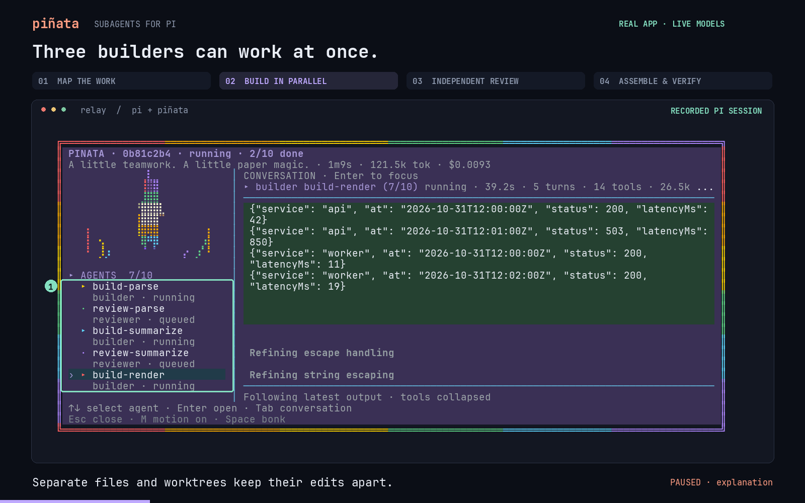

# piñata

**Pi stays small. Your subagent system should too.**

Pinata is a fast, opinionated subagent layer for Pi. Define agents, delegate bounded
work, and get dependable results. Pi keeps the harness small and lets you make it
yours. Pinata follows that lead: a small engine, a few execution modes, and useful
defaults. You wire them into your workflow.

Scout, builder, and reviewer come in the box. Planner and researcher are
[examples to steal and make your own](docs/how-to/agents.md).

Small engine. Sharp defaults. Your wiring.

[](media/pinata-demo.mp4)

[Watch the demo](media/pinata-demo.mp4) · Parallel builders, independent review, passing tests.

## Install

In Pi's terminal (_manual_):

```sh
pi install npm:pi-pinata
```

Reload Pi. You need Pi 1.1.0+, Node 22.19+ (for the `pinata` command), and Git, on Linux,
macOS or Windows. The optional researcher example uses
[pi-web-access](https://github.com/nicobailon/pi-web-access). [Herdr](https://herdr.dev/) is
optional: inside Herdr, agents can run in their own panes.

## Try this first

Ask Pi in plain language:

```text
Have a scout figure out how request validation works in this repo.
```

```text
Send two scouts out in parallel, one on the retry logic and one on its tests.
Bring back the relevant files, assumptions, and tests.
```

```text
/pinata-fix Correct the seconds-to-milliseconds conversion in src/duration.mjs.
```

```text
/pinata-review Focus on the error handling.
```

Pi picks the agents, writes their briefs, and decides who waits for whom. Start with the
[first-run tutorial](docs/tutorials/first-run.md).

## Three presets, your agents

| Agent      | What it does                                                 |
| ---------- | ------------------------------------------------------------ |
| `scout`    | Finds where the behavior lives.                              |
| `builder`  | Makes owned changes in an isolated worktree and runs checks. |
| `reviewer` | Reviews a specific change and challenges its assumptions.    |

Create a Markdown file in `.pi/pinata/agents/` or your personal
`~/.pi/agent/pinata/agents/` directory. Give it instructions, tools, a workspace,
and optional model defaults. Use its name in a task. There is no mandatory
scout → plan → build → review sequence.

```json
{
  "tasks": [
    { "id": "map-cache", "agent": "scout", "task": "Find cache invalidation and its tests." }
  ]
}
```

`pinata_agents` lists available definitions; `pinata agents show scout` inspects one.
See [creating agents](docs/how-to/agents.md).

## What it's like to use

- **Fast.** Agents share your Pi process by default. Startup, memory, and dispatch have
  [measured budgets](docs/maintainers/performance-v2.md), including tests at 64 active agents.
- **Visible.** A widget above the editor shows every agent's state, time, tokens, cost and
  current tool. `/pinata open <task>` shows an agent's whole conversation as it streams, and
  you can steer it from there. `pinata view` follows a run from another terminal.
- **Evidence you can inspect.** Writers use isolated git worktrees and engine-run checks.
  Add an independent reviewer when your workflow calls for one. The guarded handoff and
  exact integration helpers require approval of the exact artifact. Pinata hands off the exact artifact, base, checks and review;
  an optional helper applies it to your checkout without staging or committing. Unrelated
  commits may advance while builders work. Destination checks remain separate evidence.
- **Recoverable.** Runs are logged on disk. A run started with `survive: true` keeps going
  when Pi exits; the next Pi picks it up. `/pinata rerun` restarts tasks lost in a crash.
- **Scriptable.** `pinata run job.json` runs a job without an interactive Pi, with plain or
  JSONL output and exit codes for CI.

## Keep it small

Pinata reuses Pi's sessions, models, tools, and extension mechanisms. Agent definitions
and tasks are the public concepts. Instructions and results remain inspectable; each run
saves the definitions it used. Optional tool extensions load only for agents that need them.

The ambition is to run subagents well and stay small. Becoming another agent framework
is explicitly out of scope. Workflows belong in editable definitions, prompts, and
recipes. Startup, memory, context size, and dispatch costs are measured in the benchmark suite.

## Documentation

| I want to…                                 | Start here                                                                           |
| ------------------------------------------ | ------------------------------------------------------------------------------------ |
| Run my first agents                        | [First run](docs/tutorials/first-run.md)                                             |
| Build, review and apply a change           | [Build and review](docs/tutorials/build-and-review.md)                               |
| Watch agents work                          | [Watching agents](docs/tutorials/watching-agents.md)                                 |
| Choose lean or observe mode                | [Modes](docs/how-to/modes.md)                                                        |
| Run agents as processes or Herdr panes     | [Backends](docs/how-to/backends.md), [Herdr](docs/how-to/herdr.md)                   |
| Run jobs from scripts or CI                | [Headless runs](docs/how-to/headless.md)                                             |
| Give builders their dependencies           | [Dependencies](docs/how-to/dependencies.md)                                          |
| Recover, rerun or clean up                 | [Recovery](docs/how-to/recover.md)                                                   |
| Set up on Windows or macOS                 | [Platforms](docs/how-to/platforms.md)                                                |
| Look up a tool, command or config key      | [Reference](docs/README.md#reference)                                                |
| Understand how it works and what it trusts | [Architecture](docs/explanation/architecture.md), [Trust](docs/explanation/trust.md) |

The [documentation index](docs/README.md) lists everything, including maintainer docs.

MIT licensed.
