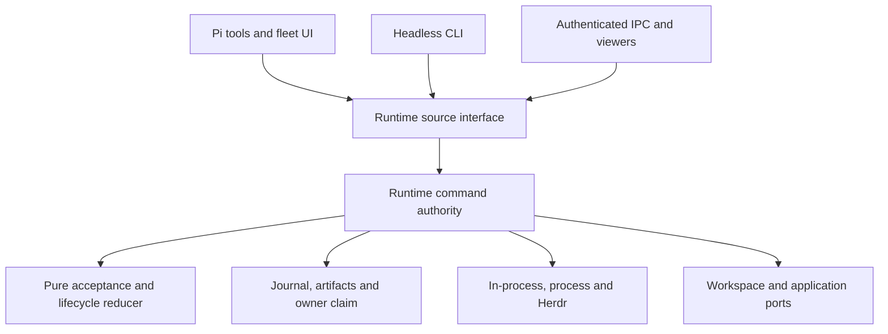

# Architecture

One Runtime accepts commands, tracks execution and records durable history. Pi,
the headless CLI, IPC clients and viewers send requests to that runtime or observe
its state. They share its scheduler and run state.

`engine/contracts` defines canonical Zod boundaries and inferred domain types.
`engine/core` contains pure graph, acceptance and transition rules, independent of
Pi and filesystem effects. `engine/storage` owns immutable artifacts, synced journal
frames, projections and atomic owner claims. `engine/runtime` serializes acceptance
and coordinates effect ports; long workspace/application waits stay outside the
command queue.

Each worker freezes a definition, model, tools, grants, loadout and workspace plan.
Assignments have monotonically increasing worker-local numbers. Dependencies,
messages, results and notifications refer to the full run/worker/assignment identity.
Adding a follow-up does not rewrite previous results or retarget existing edges.

The journal records accepted commands and effect intent before dispatch. Backend
acceptance and consumption are separate observations. An interrupted effect is not
blindly replayed. Recovery uses retained session, launch and cleanup evidence to
reattach the original attempt or report uncertainty. Projections speed reads but
cannot supersede committed history.

Backends use public Pi APIs and advertise actual capabilities. In-process workers
release idle sessions and restore saved conversations. Process workers use a durable
transport and live nonce-bound supervisor. Herdr displays an owned monitor of that
same process protocol. A missing helper/session is a capability error, not permission
to silently switch backend or discard context.

Shared checkout is the default, including non-Git projects. Isolated worktrees are
optional patch isolation. A checkout-level gate allows multiple shared writers and
excludes explicit application while writable work is active. Worktree preparation,
capture, checkpoint refs and application preserve user HEAD/index, manual commits,
dirty initial content and failed work. Application records before/after blobs and
cursor meaning atomically; uncertainty retains the gate and journal.

Definitions, selected skills, filtered parent context and scoped memory are input
data. They cannot grant capabilities. Children use a narrow parent-bound adapter and
share root capacity. Session schedules create ordinary idempotent assignments and
never revive missed occurrences after a crash.

The coordinator chooses testing, review and acceptance. There is no production
budget subsystem, ownership allocation policy, mandatory reviewer or verification
condition on exposing output. See [trust](trust.md), [API](../reference/api.md) and
[implementation evidence](https://github.com/funsaized/pinata/blob/9a6d9de/docs/maintainers/rewrite-progress.md).
