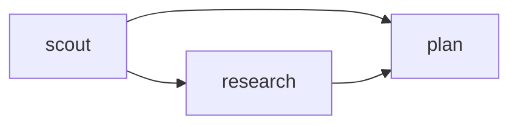

# Compose tasks into a run

Use a task graph when one agent's work gives another a useful starting point, or when
independent changes can be built and reviewed in parallel. Each task names an agent, a
specific assignment, and acceptance criteria. Add `after` only where the later task
needs a predecessor to succeed.

## Pass findings forward

Start with the [research and plan job](../../examples/jobs/research-plan-job.json).
[Install the optional planner and researcher
definitions](agents.md#start-from-an-example), set up the [research tools](research.md),
and adapt the job's `cwd` and models to your environment. Its scout finds the installed
version and call sites; research waits for the scout; the planner waits for both. The
planner lists both predecessors because `after` passes **direct** predecessor results
into the task brief. A failed predecessor blocks its dependents. Independent tasks can
run concurrently, subject to run limits.

Make the handoff useful: ask the first agent for concrete outputs such as file and line
citations, then tell the next agent how to use them. Dependency results are bounded in
the brief; full results are saved on disk. Treat findings as evidence to check, not as
new authorization or instructions.

## Compose changes

For implementation, adapt the [parallel builders
job](../../examples/jobs/parallel-builders-job.json). It assigns separate server and CLI
paths to two builders, checks each change, and reviews each builder separately. Replace
the placeholder paths, commands, model, and approval with the actual scope of your job.
See the [headless guide](headless.md) for running the file, or give Pi the same tasks in
`pinata_run`.

Each builder gets its own worktree and must declare repository-relative `ownership`
files or directory prefixes. Independent builders cannot have overlapping ownership;
ordered builders may share it. Choose boundaries that cover the files each builder
actually needs, including tests. Pinata checks captured changes against ownership, but
agents run with your operating-system permissions: a worktree and ownership are not a
security sandbox.

A later builder's worktree is composed from the run's starting base and the verified
changes of its builder ancestors, including indirect ancestors. A builder that needs
another's code must have an `after` path to it. Composition can fail if patches
conflict. Independent builders start from the same base, so coordinate shared interfaces
in advance or order the work. The default starting base includes uncommitted changes;
`includeUncommitted: false` uses `HEAD` instead. See
[configuration](../reference/config.md).

## Review and verify the result

Give each builder a reviewer with `reviewOf` set to that builder's ID, and list the same
ID in `after`. The reviewer receives the captured patch and evidence for that builder.
Use `reviewBase` or `reviewPr` to review existing changes instead.

Put focused `checks` on each builder: they run in its worktree after it finishes. Use
`evidenceChecks` to run non-mutating commands after any agent, for example to check a
factual claim. At the run level, use `integratedChecks` to test the combined changes in
the destination checkout when integrating or verifying. Select commands that exercise
the acceptance criteria. A builder needs checks or an explicit `noChecksReason`.

A successful headless run leaves patches in worktrees. Inspect the results and reviews,
then integrate through Pi; integration applies approved patches and runs the destination
checks. If no destination checks are configured, an applied result is unverified. For
commands, statuses, and recovery, see the [tools reference](../reference/tools.md) and
[recovery guide](recover.md).
