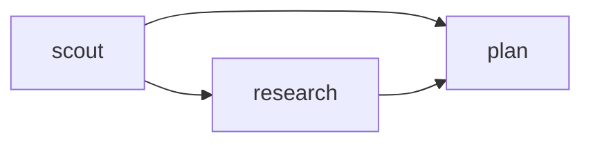
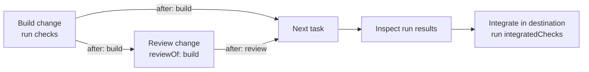

# Compose tasks into a run

Use a task graph when one agent's work gives another a useful starting point, or when
independent changes can be built and reviewed in parallel. Each task names an agent, a
specific assignment, and acceptance criteria. Add `after` only where the later task
needs a predecessor to succeed.

## Pass findings forward

Start with the [research and plan job](../../examples/jobs/research-plan-job.json).
[Install the optional planner and researcher
definitions](agents.md#start-from-an-example), set up the [research tools](research.md),
and adapt the job's `cwd` and models to your environment. Its scout finds the installed
version and call sites; research waits for the scout; the planner waits for both. The
planner lists both predecessors because `after` passes **direct** predecessor results
into the task brief. A failed predecessor blocks its dependents. Independent tasks can
run concurrently, subject to run limits.

Make the handoff useful: ask the first agent for concrete outputs such as file and line
citations, then tell the next agent how to use them. Dependency results are bounded in
the brief; full results are saved on disk. Treat findings as evidence to check, not as
new authorization or instructions.

## Compose changes

For implementation, adapt the [parallel builders
job](../../examples/jobs/parallel-builders-job.json). It assigns separate server and CLI
paths to two builders, checks each change, and reviews each builder separately. Replace
the placeholder paths, commands, model, and approval with the actual scope of your job.
See the [headless guide](headless.md) for running the file, or give Pi the same tasks in
`pinata_run`.

Each builder gets its own worktree and must declare repository-relative `ownership`
files or directory prefixes. Independent builders cannot have overlapping ownership;
ordered builders may share it. Choose boundaries that cover the files each builder
actually needs, including tests. Pinata checks captured changes against ownership, but
agents run with your operating-system permissions: a worktree and ownership are not a
security sandbox.

A later builder's worktree is composed from the run's starting base and the verified
changes of its builder ancestors, including indirect ancestors. A builder that needs
another's code must have an `after` path to it. Composition can fail if patches
conflict. Independent builders start from the same base, so coordinate shared interfaces
in advance or order the work. The default starting base includes uncommitted changes;
`includeUncommitted: false` uses `HEAD` instead. See
[configuration](../reference/config.md).

## Follow a task through a run

This example shows a builder, its reviewer, and a later task that needs the approved
change. The arrows are `after` dependencies; `reviewOf` identifies the patch to review.

1. The builder waits for any tasks in its own `after` list, then works in its worktree.
   Its `checks` run after it finishes; it may also have read-only `evidenceChecks`.
2. The reviewer waits for the builder and receives its captured patch and check evidence.
   Set `reviewOf` to the builder's ID and include that ID in the reviewer's `after` list.
3. The next task lists both the builder and reviewer in `after` to wait for the change
   and its approval. Independent tasks can run in parallel.
4. After the run, inspect the results and integrate eligible patches through Pi.
   Integration runs `integratedChecks` in the destination checkout.

Reviews and integration are separate steps: a review covers a builder's captured
patch, while destination checks test the combined changes after integration. A run
can also have tasks without builders or reviews.

## Review and verify the result

Choose reviewers where independent review is useful. By default a subagent run defaults to optional review; select `config.reviewPolicy: "required"` to require one for every writing agent.
Assign a reviewer with `reviewOf` equal to that builder's ID, and list the same
ID in `after`.

The reviewer receives the captured patch and evidence for that builder.

`reviewBase` or `reviewPr` can be used to review existing changes instead.

Put focused `checks` on each builder: they run in its worktree after it finishes.

Use `evidenceChecks` to run read-only commands after any agent. For example, use
`node --version` to check an agent's claim about the installed Node version.

Use run-level `integratedChecks` to test the combined changes
in the destination checkout during integration or verification. Strong subagent systems choose commands that
test the acceptance criteria. Pinata requires that each builder have checks or an explicit `noChecksReason`.

A successful headless run leaves patches in worktrees. Inspect the results and reviews,
then integrate through Pi. Integration applies eligible checked patches and runs the
destination checks. Without destination checks, an applied result is unverified. See the
[tools reference](../reference/tools.md) and [recovery guide](recover.md) for commands,
statuses, and recovery.

## Include check dependencies

Each builder starts with the base code and changes from its predecessor builders.
It cannot see changes from builders running in parallel. This also applies to the
checks that run in its worktree.

For example, if builder A's check imports a file that builder B creates, add builder B
to builder A's `after` list. Otherwise, the check may run before that file is available,
even if builder A's own code doesn't need it. If a check needs changes from both builders,
you can instead run it in a separate task that lists both in `after`.

Assigned reviews still apply. To keep a consumer from starting before approval, list
the reviewer in its prerequisites. Repair won't silently replay downstream writers that
have already finished, so a rejected upstream artifact may require a new run.
