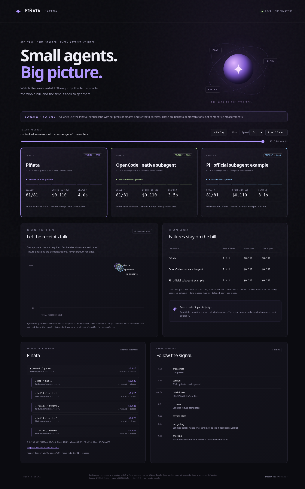
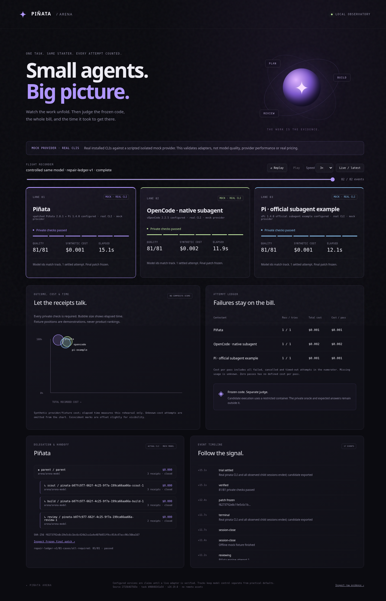

# Piñata coding arena

A local observatory for the whole coding attempt: delegation, repairs, a frozen final
patch, independent checks, total recorded spend and elapsed time. The visual demo
is runnable without a provider account. **It contains no competitive measurements
or product quality claims.** All three branded lanes use the same scripted Piñata
FakeBackend, the same starter, and synthetic receipts. Every lane is visibly marked
as a fixture. A separate mode runs the **actual pinned Piñata, OpenCode and Pi
example CLIs** against an isolated scripted provider; its receipts reconcile to
HTTP request usage. The [bundled adapters](adapters/README.md) can also target an
explicit OpenAI-compatible provider after operator authorization. No paid/live
model comparison or provider billing calibration has been run.

Commands on this page are _manual_ operator walkthroughs; the deterministic paths
are also exercised by the automated tests.



## Run the demo

Prerequisites: Node >=22.19, a local Linux Docker daemon available at
`/var/run/docker.sock`, and permission to use that daemon. Docker Desktop can be used
with its Linux socket exposed; native Windows/remote Docker are not implemented.
A Docker socket gives the operator broad host access. Contestants never receive it.
Setup downloads the pinned Node verifier image and repository dev dependencies; it
does not install or call any paid provider.

```sh
npm ci --ignore-scripts
npm run arena:setup
npm run arena:demo -- --out /tmp/arena-clean --seed 7 --step-ms 35
node examples/arena/cli.ts serve --dir /tmp/arena-clean
```

Open `http://127.0.0.1:4317`. Select a lane to inspect parent/child/repair receipts,
actual recorded model ids, the event timeline, frozen patch hash and grading result.
Replay, pause, scrub and speed controls use the same event log as the live view.
The viewer is read-only and cannot start agents, install software or make paid calls.
For live polling during generation, start `serve --dir` in a second terminal after
the runner has created that directory. Execution is sequential to limit resource
contention; the viewer shows all lanes but does not imply concurrent wall clocks.

The clean run should grade every seeded solution at 81/81 and record `$0.110` of
**synthetic** effort per attempt: parent planning/integration plus scout, builder,
reviewer and a repeated builder/reviewer. It demonstrates that repairs remain on
the bill. Times are measured on your machine, not simulated product speed.

```sh
# A seeded rotation of good, undercounting and timed-out fixtures. The assignments
# rotate with seed; there is no hard-coded branded winner.
node examples/arena/cli.ts demo --out /tmp/arena-faults --scenario faults --seed 7
node examples/arena/cli.ts replay --dir /tmp/arena-clean
npm run test:arena
ARENA_DOCKER_TEST=1 npm run test:arena
```

Generation timeouts use the 30-second demo limit. The Docker regression suite uses
shorter limits and also tests verifier hangs, process failure, cancellation, unknown
cost, output bounds, descendant termination, protected files and host/network access.
The repository-only recorded [example run](example-run/results.json) is an actual deterministic
rehearsal, with its event log and final patches. It is **not a model evaluation**.
Run it without Docker using `serve --dir examples/arena/example-run`; generating
or regrading a candidate requires Docker. [Validation evidence](VALIDATION.md)
records the actual checks and remaining limitations.

## Exercise the real CLIs without model spend

On Linux x64, build the adapter image and run its separate mock provider. Setup
fetches the checksum-pinned OpenCode 2.2.5 binary and locked Pi 1.4.0 dependencies;
it does not use provider credentials. Docker generation containers can reach only
the internal mock network. The mock's canned tool responses are outside the
contestant image, and the grader remains outside both.

```sh
npm run arena:adapters:build
npm run arena:mock -- --out /tmp/arena-real-clis
node examples/arena/cli.ts serve --dir /tmp/arena-real-clis
```

This runs Piñata's process backend, OpenCode's native subagents, and the Pi 1.4.0
**official subagent example extension**. Each performs a real scout/build/review
workflow, exports a final patch and passes through the same independent verifier.
The viewer says **MOCK PROVIDER · REAL CLIS**, with synthetic cost. OpenCode's
auxiliary requests are recorded as provider overhead when absent from session
exports. [Recorded mock evidence](mock-example-run/provider-audit.json) compares
all HTTP requests to the ledger. Scripted outcomes prove integration and metering,
not model quality, speed or product superiority. Recorded samples replay without
installing these products: `serve --dir examples/arena/mock-example-run`.



Live configuration, public CA mounting, dated price estimates and supported model
limitations are documented in the [adapter walkthrough](adapters/README.md).

## What is executed and measured

Each outer attempt starts with a copy of only `task/public`. The fixture engine
produces a canned implementation, exercising a real `createEngine` + `FakeBackend`
scout → builder → reviewer graph and then a repair/re-review. The parent actions,
checks, review and integration labels in this trace are scripted. The final check
result comes from a real independent verifier after the candidate is frozen.

For a live protocol adapter, the same runner starts a digest-pinned container with
only its own image, fresh workspace, public input and explicitly named credentials.
It accepts incremental JSONL receipts for parent, children, retries, compaction and
overhead. It enforces terminal-state, wall-clock, output, allowed-file and freeze
rules, removes the container, then grades a read-only candidate in a **different**
container. It records configured versions, source and task digests, actual local
image ids, the actual source-file hashes and observed child models. Model-control
mismatches are flagged as incomparable.

All generated source is untrusted, even in the demo. The verifier's driver runs in
a no-network container with a read-only root and candidate, no capabilities,
`no-new-privileges`, an unprivileged user, memory/CPU/pid limits and a bounded tmpfs.
The private oracle and expected answers stay on the host; only the driver and case
inputs enter this container. Generation has already stopped, and receives neither
grading inputs nor feedback. There is no host-execution fallback if Docker fails.
Container removal is checked before patch freeze. Worktrees and ordinary directories
are not security sandboxes. Containers share the host kernel; use a dedicated VM
and a restricted egress gateway for hostile real agents.

The wall clock starts immediately before generation and ends after final freeze,
independent verification and cleanup. Separate generation and verification durations
are retained. Setup/image download and starter-copy time are excluded. Container
startup and adapter-side planning/review/integration are included in generation.
Do not compare these local rehearsal times to model/provider performance.

All rubric cases must pass for success. Case-pass counts are a diagnostic, not a
universal code-quality score or aesthetic review. Failed generation has no candidate
quality score. Nonzero exits, missing/late terminals, bad receipts, deadline,
cancellation, freeze violations and infrastructure failures remain explicit.

Cost is the sum of distinct incremental receipts across the entire attempt. Unknown
fields stay null; known partial sums remain visible. The bundled adapters reconcile configured HTTP requests with session receipts;
missing or mismatched usage makes totals unknown. This is not a provider invoice audit. Failed, cancelled and timed-out attempts
remain in the success-denominator cost. Zero successes has an undefined cost per
success; any missing cost makes that metric unknown. Provider receipts, dated
estimates and synthetic prices have distinct provenance.

**Spend limits are observed per-attempt cancellation thresholds, not hard billing
caps or a multi-trial provider budget.** In-flight calls, unreported child activity,
subscription billing and an incomplete adapter can exceed them. Configure provider
account limits and authorize an explicit trial count before a live run. `live`
requires a separate `--allow-provider-spend` flag; no paid runs are included here.

## Controlled and practical tracks

- `controlled-same-model`: request the same exact provider/model, including every
  child and compaction model. Capture thinking settings, context limits, tool grants
  and prompts in the pinned adapter configuration. The runner checks observed ids,
  not undocumented provider internals. A mismatch stays in the evidence and is
  marked incomparable; it must not be ranked as a controlled result.
- `practical-defaults`: preserve and record each stack's actual defaults and agent
  models. Report this as a different question, not evidence of a model-controlled
  product advantage. Do not mix these runs with the controlled cohort.

Use identical public tasks, independent unpublished repetitions and predeclared
criteria. Rotate execution order across repetitions. The runner creates a fresh
workspace and sessions each time and returns no grading feedback to an agent. It
does not prevent an externally networked provider from remembering prior tasks;
use fresh sessions/account-side controls. A proposed 6-task × 3-stack × 3-repeat
study is future work, **not** a command to run 54 paid trials. This PR ships one
public rehearsal task and no comparative study results.

## Private task packages

For real trials, prepare an unpublished trusted directory outside contestant images:

```text
my-private-task/
  task.json
  public/                 # Only these files reach a contestant
    requirements.md
    solution.mjs
    public-check.mjs
  grading.mjs             # Trusted host code, never mounted in generation
```

`task.json` uses the shipped schema: `schema: 1`, a simple `id`, entry filename,
prompt filename and `publicFiles` allowlist. Files are flat, bounded UTF-8 source;
symlinks, additional files and edits to public files other than the entry are
rejected. This deliberate first task scope avoids running arbitrary repository
build/install scripts. Multi-file application tasks need an expanded reviewed task
format; they are not silently accepted by this harness.

`grading.mjs` exports `prepare(seed)` returning `{ cases, expected, driver, rubric }`.
The trusted host computes expected JSON results. The driver reads the case array
from stdin, loads the candidate under `/work`, and writes a JSON array of results.
The host compares results structurally. Keep the oracle/expected answers out of the
driver. The shipped task covers repairs, duplicated delivery, malformed records,
number overflow, ordering, statuses and mutation. Seeds are identical for all
contestants in a repetition and differ across repetitions. The fixture command
supports only the shipped task; live configs may select a private package.

The supplied task and oracle are public examples, so they are unsuitable as hidden
benchmarks. A private grading package is trusted operator code, not an agent input;
never import a contestant-provided grader on the host.

## Evidence and replay

Each run directory contains:

- `manifest.json`: pinned setup, track, limits, versions and source/task hashes;
- `events.jsonl`: ordered attempt and protocol events, including partial failures;
- `results.json`: all terminal attempts and success-denominator aggregates;
- `<attempt>/candidate`, `final.patch`, `result.json`: frozen output and receipts;
- `<attempt>/engine`: fixture engine trace (demo only);
- `<attempt>/adapter.stderr.txt`: bounded diagnostics (live only).

The local viewer serves no arbitrary file route, credentials, private task package,
raw stderr, grading inputs or oracle. It uses no remote assets. Replay rebuilds the
ledger from protocol receipts, checks it against settlements, and recomputes
aggregates. An incomplete/truncated tail remains marked incomplete. A hard process
kill can leave an unfinished attempt; replay does not pretend it was free or
successful. There is no automatic resume/retry of a live attempt, which could
otherwise spend twice or reuse grading feedback. Inspect container state and create
a fresh authorized attempt instead.
