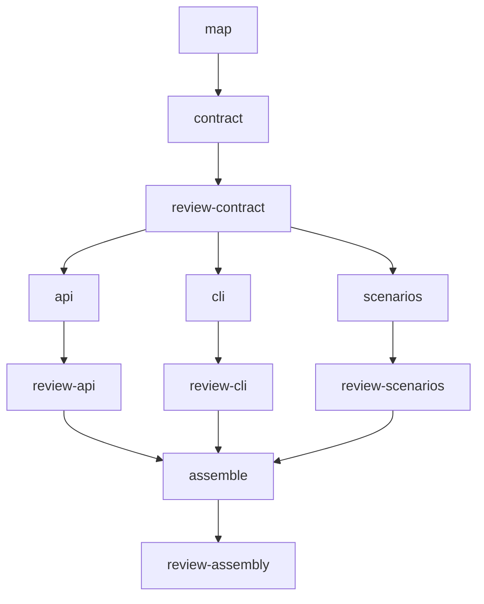

# Task and job examples

A job turns a goal into work piñata can run: named tasks, agents, dependencies,
file ownership, and checks. Job plans are plain JSON files. Create them with your
agent, edit them in your text editor, and run them from a terminal or CI. The job
schema lets a coordinator turn an existing plan into explicit, reusable steps.

## Let a coordinator design the job

With Pinata installed in Pi, describe your goal and ask Pi to use Pinata. The
bundled `subagents` skill guides the coordinator in inspecting the repository and
designing tasks, dependencies, ownership, and checks. The skill directs the
coordinator to discover your personal and repository agent definitions and consider
them alongside the presets before decomposing the goal into tasks. Ask it to save a job file
when you want a reusable plan or headless execution.

The coordinator decides:

- Which questions need scouts before implementation starts.
- Which builders can work in parallel, with separate owned files.
- Which tasks must wait for earlier results or reviews.
- Which models and agent definitions fit each assignment.
- What checks and independent reviews will establish that the work is ready.

You can use a stronger model for these decisions and choose worker models per
task or agent. The coordinator's model is the one running your Pi session;
the job's model settings choose the workers. If a task needs a specialist, the
coordinator can [create an agent definition](../docs/how-to/agents.md) before
running the job. Otherwise, scout, builder, and reviewer cover common coding work.

For example, ask Pi to prepare a migration:

```text
Use Pinata to inspect this repository
and plan the migration from our old logging API to the replacement we selected.

Save a job.json with the necessary agents and concrete acceptance criteria.
Use scouts where call sites or behavior are unclear. Split independent packages
between builders with separate ownership, and order any shared API changes first.
Give each builder an independent reviewer. Use our existing tests for task checks
and define integratedChecks for the combined result.

Use my configured models and limits. Explain the task graph and any unresolved
decisions before running it.
```

Once the plan is ready, Pi can run it, inspect the saved results, repair builders
in the same run, and integrate approved changes. Pinata executes the declared
dependencies; the coordinator makes the follow-up decisions. An optional `planner`
worker returns a proposal for the coordinator to turn into tasks and launch.
For headless execution, [`pinata run`](../docs/how-to/headless.md) applies successful
changes and runs destination checks. Use `--no-apply` to inspect the artifacts first.

## Where jobs help

Pinata makes repeatable delegation first-class with job definitions. Save the task graph once,
then adapt its inputs and checks for the next feature, package batch, research round,
or dataset.

The pinata source here includes some hypothetical scenarios of jobs to get you started. Their JSON files show complete job shapes, but their paths, commands, and
assignments must be adapted to your own work. For a runnable starter repository,
see [Relay](../docs/tutorials/relay.md).

| Goal                                              | Job                                                                  | What the graph makes possible                                                                                                       |
| ------------------------------------------------- | -------------------------------------------------------------------- | ----------------------------------------------------------------------------------------------------------------------------------- |
| Deliver a feature from an approved specification  | [Feature delivery](jobs/feature-delivery-job.json)                   | Review a shared contract, build API and CLI branches alongside independent scenarios, then test their composition.                  |
| Apply one migration across many packages          | [Batch migration](jobs/batch-migration-job.json)                     | Inventory once, repeat a builder/reviewer pair per package, and summarize a bounded batch.                                          |
| Choose a technology from competing evidence       | [Research decision](jobs/research-decision-job.json)                 | Research alternatives in parallel, challenge decisive claims, then propose a decision or experiment.                                |
| Turn user evidence into an implementation backlog | [UX discovery](jobs/ux-discovery-job.json)                           | Analyze interviews, support cases, and the current journey separately; synthesize and challenge the findings.                       |
| Repair accessibility across a user journey        | [Accessibility remediation](jobs/accessibility-remediation-job.json) | Fix components in parallel, review each patch, then exercise their combined keyboard and error-recovery behavior.                   |
| Process and reconcile partitioned data            | [Data pipeline](jobs/data-pipeline-job.json)                         | Review a data contract, transform partitions independently, then merge with lineage, reject accounting, and reproducibility checks. |

### Feature delivery: specification to verified composition

The [feature delivery job](jobs/feature-delivery-job.json) adds an audit-export
feature to an API and CLI. First, a scout looks at the approved specification and
existing test setup. A builder then defines how the pieces will fit together, and
a reviewer checks that agreement before three branches of work begin:



This diagram shows the execution stages; the JSON also names direct dependencies
where a task needs the original result in its brief. The API and CLI builders own
separate source and test paths. The scenario builder derives end-to-end cases from
the specification while implementation proceeds. Its syntax check is deliberately
limited: behavioral execution waits for `assemble`, whose worktree contains all
three branches. A final review checks that evidence, and `integratedChecks` rerun
validation in the destination when changes are integrated.

This adapts the specification-and-scenario approach described by
[StrongDM's software factory](https://factory.strongdm.ai/). Here, scenarios have
separate authorship and ownership; they are still visible repository files, not
hidden holdout tests. Reuse the shape for an SDK and server, a parser and renderer,
or a feature spanning frontend and backend. Keep deployment as a separate workflow.

### Batch migration: one recipe, many bounded assignments

The [batch migration job](jobs/batch-migration-job.json) replaces old logging calls
in three packages. A scout first finds the calls and any shared risks. Each package
then gets a builder and reviewer, along with checks for regressions and remaining
old calls. A planner summarizes the successful work, and the full workspace tests
run when the changes are integrated. Install the optional planner definition for
the summary task.

Scale this by expanding the explicit package list into task entries before launch.
Each new package needs unique task IDs, ownership including its tests, a reviewer,
and an entry in the summary's `after` list. Keep shared dependency or lockfile
changes in an earlier job or ordered prerequisite. For multiple repositories,
prepare one job per checkout: a job has one `cwd`.

Use the same pattern for API deprecations, localization updates, test-framework
migrations, or documentation repairs. Start with a representative batch, inspect
its results, and reuse the corrected recipe for the next batch. Increasing the
number of tasks does not require running all of them at once.

### Research: compare, challenge, decide

The [research decision job](jobs/research-decision-job.json) helps choose between
PostgreSQL full-text search, Meilisearch, and OpenSearch. A scout identifies the
repository's requirements, and three researchers compare the options using the same
criteria. Another researcher checks important claims and conflicting evidence.
Finally, a planner recommends a choice or a small experiment to answer an open question.

Each report must distinguish documented capabilities from measurements and include
version applicability and inspected sources. The challenge step can correct a
claim instead of simply adding another vote. This adapts the scoped parallel
research and citation-checking practices in
[Anthropic's research system](https://www.anthropic.com/research/multi-agent-research-system).
Reuse it for an upgrade, build-versus-buy investigation, protocol choice, or incident
hypothesis comparison. Install the optional researcher and planner definitions and
[configure research tools](../docs/how-to/research.md) first.

### UX discovery: observations to testable changes

The [UX discovery job](jobs/ux-discovery-job.json) looks for ways to improve
onboarding using existing interviews, support cases, journey notes, and the current
implementation. Scouts review the evidence separately, and a planner brings their
findings together. Another scout checks those findings against the original records,
then a planner proposes a prioritized backlog and the next usability session.

Findings preserve source IDs, contradictory cases, and the distinction between an
observation, an interpretation, and a proposed change. This follows the evidence
separation in the
[GOV.UK research analysis guide](https://www.gov.uk/service-manual/user-research/analyse-a-research-session).
The job analyzes supplied research; it does not simulate participants or establish
that a proposed design works. Reuse it after each research round, with new evidence
and stable session IDs, or apply it to checkout, account recovery, and support flows.

### Accessibility: component repairs to journey evidence

The [accessibility remediation job](jobs/accessibility-remediation-job.json) starts
with recorded accessibility issues in checkout. Two builders fix dialogs and form
fields in parallel, each with tests and a review. A later builder tests the combined
changes in a browser: opening the dialog, correcting invalid input, completing the
flow, and checking that focus returns where it should. The checks also include the
configured automated accessibility scan.

The example assumes an existing browser harness; preset scouts and reviewers read
source and logs rather than operating a browser. The final result records remaining
screen-reader, zoom/reflow, and user evaluation work. Passing the automated checks
is evidence for the tested flow, not a conformance determination:
[W3C's evaluation guidance](https://www.w3.org/WAI/test-evaluate/) calls for
knowledgeable human evaluation alongside tools. Reuse the graph for another journey
or component set, adapting checks to the actual findings.

### Data processing: partition, validate, reconcile

The [data pipeline job](jobs/data-pipeline-job.json) processes two monthly order
files. A scout inspects the inputs, and a profiling command examines the full data.
A builder writes the approved business rules into a data contract for review. Then
separate builders use an existing ETL tool to process each file. Each output includes
accepted records, quarantined records, and a manifest with checksums for the input
and contract.

A downstream builder receives both reviewed partitions and produces the curated
dataset. Checks recompute row accounting and exact amount totals by currency from
the raw inputs, handle duplicate keys across partitions, and verify reproducibility.
No row should disappear between raw input, rejection, duplicate accounting, and
final output. Agents coordinate the work and investigate anomalies; the ETL code
performs parsing, normalization, and arithmetic. This uses a bounded batch shape;
for the broader partitioning and repeatable-transform principles, see the
[Apache Beam programming guide](https://beam.apache.org/documentation/programming-guide/).

Reuse the graph for catalog normalization, content imports, fixture generation, or
reconciliation batches. This template targets small, versionable outputs captured
as builder patches. Large datasets need external artifact storage and a suitable
runner; piñata does not supply a streaming engine or the example's ETL script.

## Compose and reuse a job

The examples combine chaining, parallel work, and independent evaluation, patterns
also described in
[Anthropic's workflow guide](https://www.anthropic.com/research/building-effective-agents).
Map them to piñata's actual fields:

| Pattern                                 | How to express it                                                                                                                                                                                                |
| --------------------------------------- | ---------------------------------------------------------------------------------------------------------------------------------------------------------------------------------------------------------------- |
| Run independent assignments in parallel | Give each task an ID; omit dependencies between independent tasks. Bound active workers with `config.limits.concurrency`.                                                                                        |
| Pass evidence forward                   | List direct predecessors in `after`; their results are included in the next brief. Ask for a consistent evidence format and cite full saved results when summaries are too large.                                |
| Combine built artifacts                 | Give the downstream **builder** an `after` path to each contributing builder. Its worktree includes verified changes from all builder ancestors. A read-only planner receives findings, not a composed checkout. |
| Require review before continuing        | Give each reviewer `reviewOf` and the same builder ID in `after`; make downstream work depend on the reviewer as well. A rejected review blocks its dependents.                                                  |
| Validate claims and behavior            | Use non-mutating `evidenceChecks` for factual evidence, builder `checks` for owned changes, and `integratedChecks` for the combined destination.                                                                 |
| Improve a rejected patch                | Have the coordinator call `pinata_repair` with concrete feedback within `limits.repairs`; associated reviews rerun. The JSON does not declare an automatic repair loop.                                          |

A saved job is an explicit task graph. There are no template variables, `foreach`,
conditional routing, or automatic task generation in these JSON files. The
coordinator expands a target list, chooses a branch, or creates a follow-up job.
A planner's proposed tasks are a result for the coordinator to act on. For recurring
execution, invoke the adapted job from your existing CI or scheduler.

Before reusing a graph:

1. Set `cwd`, input paths, target versions, and acceptance criteria. Replace the
   approval placeholder with the authorized scope for jobs that write files.
2. Confirm the named tools, input files, fixtures, and commands exist. These
   templates illustrate repository contracts; they do not install test harnesses,
   create research inputs, or supply the ETL runner. Checks must test the behavior
   they claim, exit on failure, and clean up any local services or temporary data.
3. Choose ownership boundaries, including tests and generated outputs. Independent
   builders must not overlap. Serialize shared changes or give them a prerequisite.
4. Choose configured models and adjust concurrency, time, cost, and repair limits.
   The larger templates inherit your models; their dollar limits are example caps,
   not cost estimates. Use bounded batches when the target list is large.
5. `pinata run` applies successful changes and runs destination checks. Use
   `--no-apply` to inspect results first, then `pinata integrate <run>`. A failed
   or rejected predecessor blocks downstream summaries too, so inspect saved task
   results when a batch fails. If a repair would invalidate completed downstream
   builders, create a new run; see [recovery](../docs/how-to/recover.md).

Each execution makes fresh model calls. Reuse the plan and evaluation criteria,
then assess the new evidence rather than assuming a previous result still applies.

## Adapt the examples

The small task objects below explain individual roles. For composed workflows,
start with the [complete jobs](#complete-jobs). Copy these objects into a job file
or use them when building an integration. For everyday delegation directly in Pi, use the [chat assignments](README.md).

All jobs run real agents with your configured model credentials and spend tokens.
Replace template models, paths, and checks with ones that fit your repository, and
set limits before launching. For a prepared starter and complete walkthrough, use
[Relay](../docs/tutorials/relay.md).

Put these task objects in a complete job's `tasks` array. See the
[tool reference](../docs/reference/tools.md) and [configuration](../docs/reference/config.md).
The planner and researcher tasks require installing the optional
[agent examples](../docs/how-to/agents.md#start-from-an-example).

## Scout: find local evidence

This task fits a small greeting repository (`greet.mjs` and its test):

```json
{
  "id": "scout",
  "agent": "scout",
  "task": "Read greet.mjs and greet.test.mjs. Locate whitespace handling and the test that should cover it.",
  "acceptance": [
    "Cite the relevant function and test by file and line.",
    "Explain current behavior and suggest a regression test without editing or running it."
  ]
}
```

The result should contain a `brief` with file references and an empty changed-file
list. Scouts suggest tests from source inspection; builders or engine checks can
execute them.

## Research: answer a question from sources

```json
{
  "id": "research",
  "agent": "researcher",
  "task": "Fetch the official Node.js 22.19.0 test-runner documentation. Confirm whether node --test greet.test.mjs is the documented way to run one .mjs test file. Report any evidence gaps.",
  "acceptance": [
    "Cite an inspected official source and the command it supports.",
    "State whether the source applies to Node.js 22.19.0.",
    "Report missing tools, authentication, or failed fetches as blockers."
  ]
}
```

The result should contain a brief and `sources` entries with `url`, `title`,
`supports`, and `applicability`. Check that the researcher read the cited sources.
A failed fetch should be reported as a blocker, without inventing a citation or
silently switching providers.

## Planner: propose the work

Include the `scout` task above in the same run before adding this task:

```json
{
  "id": "plan",
  "agent": "planner",
  "task": "Use the scout's evidence to plan trimming surrounding whitespace in greet. Name owned files, the regression check, review criteria, and integration order. Do not implement it.",
  "acceptance": [
    "Keep the change limited to greet.mjs and greet.test.mjs.",
    "Include a test for surrounding spaces and preserve the current greeting.",
    "Specify a builder followed by an independent reviewer."
  ],
  "after": ["scout"]
}
```

Expect a `brief` describing the proposed work. The coordinator decides which tasks
to launch and confirms that proposed commands fall within your authorization.

## Builder: make a bounded change

The enclosing job must record the authorized write scope in `approval`. Supply
approved checks or an explicit `noChecksReason` before submitting the task.

```json
{
  "id": "build",
  "agent": "builder",
  "task": "Trim surrounding whitespace in greet's string argument and add a regression test. Preserve internal spaces and the existing plain-name greeting.",
  "acceptance": [
    "greet(' Ada ') returns 'Hello, Ada!'.",
    "The existing test and the new whitespace regression pass."
  ],
  "ownership": ["greet.mjs", "greet.test.mjs"],
  "checks": [
    {
      "id": "greeting",
      "argv": ["node", "--test", "greet.test.mjs"],
      "timeoutMs": 30000
    }
  ]
}
```

The result should list the files actually changed and include checks run by the
engine. Read those logs, then collect an independent review before integration.

## Reviewer: challenge the actual result

Add this alongside or after the `build` task above:

```json
{
  "id": "review",
  "agent": "reviewer",
  "task": "Inspect the greeting builder's actual changes and check evidence. Check surrounding and internal whitespace behavior, scope, and regression coverage.",
  "acceptance": [
    "Cite evidence for any defect.",
    "Approve only if the current changes meet the builder's acceptance criteria."
  ],
  "after": ["build"],
  "reviewOf": "build"
}
```

To review changes that already exist, replace `reviewOf` and `after` with
`"reviewBase": "HEAD"` (your uncommitted changes), `"reviewBase": "main"` (your
branch since `main`), or `"reviewPr": 482` (a GitHub pull request, fetched with
`gh`). Such a job needs no builder or write approval.

The reviewer returns `approve` or `changes_requested`, tied to the exact patch's
fingerprint. Approval cannot include unresolved medium, high, or critical findings.
For a rejection, [repair the builder and rerun its review](../docs/how-to/recover.md#repair-a-failed-task)
in the same run.

## Model configs

Each file in [configs/](configs/) is a `config` object. Copy one to
`~/.pi/agent/pinata.json` for your defaults, or to a project's `.pi/pinata.json`
for that project; pinata reads both automatically. You can also paste one into a
job's `config` field. Update them with the models you use:

| File                                         | When to use it                                                                                       |
| -------------------------------------------- | ---------------------------------------------------------------------------------------------------- |
| [luna.json](configs/luna.json)               | One model for every role, with less thinking for scouts and more for reviews                         |
| [per-role.json](configs/per-role.json)       | Luna scouts and builds, Sol researches, Astra plans and reviews; DeepSeek Flash backs up the builder |
| [research.json](configs/research.json)       | Research on Sol, with a search key passed through; pi-web-access is found automatically              |
| [no-codemode.json](configs/no-codemode.json) | A model that handles codemode poorly; raises `maxTurns` to compensate                                |
| [pinata.config.json](pinata.config.json)     | An example with explicit limits                                                                      |

It is recommended to pick models and thinking levels by role. For example, scouts mostly read, so `low` is
usually enough. A different reviewer model can bring a different perspective; `per-role.json` reviews
Luna's work with Astra. Fallbacks apply only
when the preferred model is unavailable or unauthenticated. Use
[task recovery](../docs/how-to/recover.md) to address failed work.

## Complete jobs

Each file in [jobs/](jobs/) is an example job for `pinata run` based on a
hypothetical starting point. Adapt `cwd`, `approval`, assignments, paths, and
checks to your goal and repository before use, or ask your coordinator to do so.

| File                                                                          | Shape                                                                                       |
| ----------------------------------------------------------------------------- | ------------------------------------------------------------------------------------------- |
| [feature-delivery-job.json](jobs/feature-delivery-job.json)                   | 11 tasks: shared contract, three parallel branches, reviews, and composed scenario checks   |
| [batch-migration-job.json](jobs/batch-migration-job.json)                     | 8 tasks: inventory, three package migrations with reviews, and a batch summary              |
| [research-decision-job.json](jobs/research-decision-job.json)                 | 6 tasks: constraints, three research branches, challenge, and decision brief                |
| [ux-discovery-job.json](jobs/ux-discovery-job.json)                           | 6 tasks: parallel evidence extraction, synthesis, challenge, and UX backlog                 |
| [accessibility-remediation-job.json](jobs/accessibility-remediation-job.json) | 7 tasks: audit, two component repairs with reviews, and a reviewed journey test             |
| [data-pipeline-job.json](jobs/data-pipeline-job.json)                         | 9 tasks: profiling, reviewed contract, two reviewed partitions, and reviewed reconciliation |
| [fast-fix-job.json](jobs/fast-fix-job.json)                                   | One bounded fix and independent review                                                      |
| [node-deps-job.json](jobs/node-deps-job.json)                                 | Scout, builder, reviewer on an npm project; setup is detected from the lockfile             |
| [monorepo-setup-job.json](jobs/monorepo-setup-job.json)                       | Explicit `setup` that installs one pnpm workspace package                                   |
| [parallel-builders-job.json](jobs/parallel-builders-job.json)                 | Two independent builders with separate ownership, each with its own review                  |
| [research-plan-job.json](jobs/research-plan-job.json)                         | Read-only: scout, then version-specific research, then a plan                               |
| [review-changes-job.json](jobs/review-changes-job.json)                       | Read-only: two reviewers on the branch since `main`, with a $2 cost limit                   |

In `parallel-builders-job.json`, setup copies `node_modules` from your checkout
(`$PINATA_ROOT`) instead of installing. Copy-on-write filesystems can make this
faster, but the command trusts your checkout's dependencies to match the lockfile.
Use the detected `npm ci` when they might not.

## Files you can copy

| File                                               | Use                                                                             |
| -------------------------------------------------- | ------------------------------------------------------------------------------- |
| [scout-job.json](scout-job.json)                   | Complete read-only scout job                                                    |
| [tutorial-build-job.json](tutorial-build-job.json) | Complete greeting builder and reviewer job                                      |
| [job.json](job.json)                               | Generic builder/reviewer template; replace all assignment and path placeholders |
| [configs/](configs/)                               | Model and behavior configs; see [Model configs](#model-configs)                 |
| [jobs/](jobs/)                                     | Complete jobs for common shapes; see [Complete jobs](#complete-jobs)            |

`npm test` validates every config and job here against pinata's input contracts.

Model and path placeholders are deliberate. Never execute them unchanged or put
credentials into these files.

[Documentation index](../docs/README.md)
