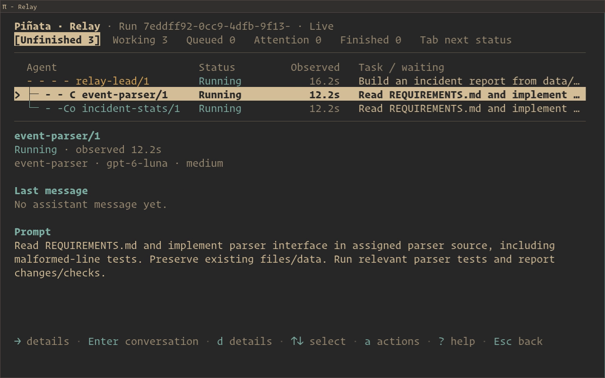

# The Relay build

[](pinata-demo.mp4)

[Full build (2m 04s)](pinata-demo.mp4) · [Hero GIF (29s)](pinata-navigation.gif) · [Share the poster (PNG)](pinata-fleet.png)

| Time | What to watch                                                                                                                                                                                                    |
| ---- | ---------------------------------------------------------------------------------------------------------------------------------------------------------------------------------------------------------------- |
| 0:00 | Three Markdown files define the team. The lead's `handoffs` field names both specialists.                                                                                                                        |
| 0:17 | The user types the request in Pi. After submission, `event-parser` and `incident-stats` appear beneath `relay-lead`.                                                                                             |
| 0:47 | `incident-stats` writes `src/summarize.mjs` and tests nearest-rank p95. In its 20-event sample, p95 is 19 ms.                                                                                                    |
| 1:02 | `event-parser` writes `src/parse.mjs` and its tests. The test output shows that valid events survive on both sides of a malformed line.                                                                          |
| 1:09 | The lead reads the specialists' work. Its transcript shows the `pinata_children` call that assigned both jobs and its own writes to `src/render.mjs` and `bin/relay.mjs`.                                        |
| 1:36 | The coordinator runs all ten tests, then prints **4 events, 1 failure, 0 invalid lines**. `node verify.mjs` matches the CLI output to the [supplied report](../examples/relay/expected-report.md) byte for byte. |

## Rebuild the exports

Both cuts come from one live Pi 1.5.0 session in a standalone Foot window. The poster is the frame at 1m 18.5s in the [source recording](relay/session.mp4).

Run the exporter from the Piñata checkout. It needs Python 3.10+ and FFmpeg with libx264.

```sh
python3 media/relay/export.py /tmp/relay-exports
```

## Record a fresh build

Get authorization for provider spend before submitting a live task. This take used OpenAI `gpt-6-luna`. From the Piñata checkout with dependencies installed, open a standalone Foot window with Bash. The take uses 95 columns, 25 rows and 18 pt Operator Mono.

```sh
foot -T Relay -W 95x25 -f 'Operator Mono:style=Book:size=18' \
  -o 'font-bold=Operator Mono:style=Bold:size=18' \
  -o 'font-italic=Operator Mono:style=Book Italic:size=18' \
  -o 'font-bold-italic=Operator Mono:style=Bold Italic:size=18' \
  -o line-height=22 -o pad=16x12 bash --noprofile --norc -i
```

Prepare a new Relay checkout inside that window.

```sh
repo=$PWD
take=$(mktemp -d)
node examples/relay/setup.mjs "$take/Relay"
mkdir -p "$take/Relay/.pi/pinata"
cp -R examples/agents/relay "$take/Relay/.pi/pinata/agents"
cp examples/relay/recording/pinata.json "$take/Relay/.pi/"
node -e 'console.log("/pinata-grants " + JSON.stringify(require("./examples/relay/recording/grants.json")))'
cd "$take/Relay"
```

On a wlroots desktop, run the following in a second terminal and select the whole Foot window. The original frame measures 1280 × 800 pixels. Press Ctrl+C in the recorder after the verifier result has been on screen for several seconds.

```sh
wf-recorder -g "$(slurp)" --no-damage -r 12 -c libx264 -p crf=13 -x yuv420p -f relay-window.mkv
```

In the Relay window, show the [project definitions](../examples/agents/relay) and launch Pi with your terminal colors enabled.

```sh
ls -1 .pi/pinata/agents
grep '^handoffs' .pi/pinata/agents/relay-lead.md
env -u NO_COLOR COLORTERM=truecolor PI_TELEMETRY=0 \
  "$repo/node_modules/.bin/pi" --offline --no-session --no-extensions --no-skills \
  --no-prompt-templates --no-context-files -e "$repo/engine/pi/extension.ts" \
  --model openai/gpt-6-luna --thinking medium
```

1. Submit the printed `/pinata-grants` command, then `/pinata-new`. The [host grant](../examples/relay/recording/grants.json) allows the lead to delegate one level to its two specialists in the shared checkout. The [project config](../examples/relay/recording/pinata.json) gives all three workers a slot. See the [nested-delegation example](../README.md#nested-delegation).
2. Show the input with `!cat data/events.jsonl`. Type the request below in Pi and hold it on screen before pressing Enter.
3. Press Shift+Down for the fleet. Hold on the expanded tree, then select a child and press Enter. Shift+Left and Shift+Right switch between workers. In the lead's conversation, press Tab to focus the transcript and use the arrow keys to scroll back to its tool calls.
4. Return to the coordinator. Run `!node --test --test-reporter=spec`, `!node bin/relay.mjs data/events.jsonl` and `!node verify.mjs`.

```text
@relay-lead Build an incident report from data/events.jsonl. Give parsing and service statistics to your specialists, wire their work into the CLI, and show me the report.
```
